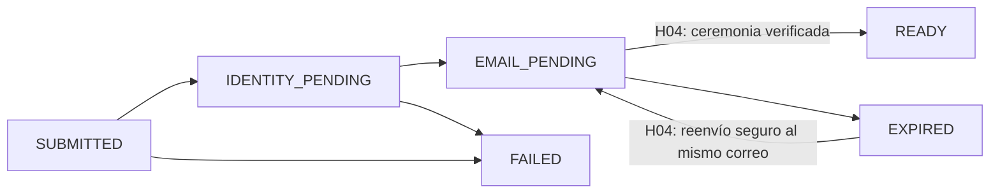

# Plan de ejecución — I1-H03 Registrar empresa y primer administrador

- Estado del plan: `PROPOSED_FOR_APPROVAL`.
- Fecha: 2026-11-02.
- Rama documental: `docs/i1-h03-execution-plan`.
- Base: `increment/01-company-identity-catalog`, commit `f387f260acc0b32ed8a85373cf12d45476371ebe`.
- H02: integrada mediante ese SHA y `DONE / ACCEPTED` localmente, confirmado expresamente por el Product Owner el 2026-11-02. Se conserva la [aceptación funcional y su evidencia](../reviews/aceptacion-i1-h02.md).
- Autorización vigente: preparar este plan, registrar la integración, actualizar documentación, commit, push y Draft PR al incremento. **Implementación de H03 no autorizada**; ninguna entrega ha comenzado.
- Checks remotos de esta entrega: los verifica e informa el PO; el agente no los espera ni supervisa.

## 1. Fuentes y límites de la propuesta

Orden de autoridad consultado: [especificación técnica](../ProPractix-V2-MVP-Espana-Especificacion-Arquitectura-y-Tecnica-para-Codex.md), [blueprint de dominio](../ProPractix-V2-Blueprint-Dominio-y-Mapas-Legales-Espana.md), ADR aceptados y [contrato de H03 del plan aprobado, revisión 7](increment-01-plan.md#i1-h03--registrar-empresa-y-primer-administrador). Este documento descompone ese contrato; no sustituye los ADR ni aprueba políticas.

| Fuente | Aplicación en H03 |
|---|---|
| [ADR-001](../adr/ADR-001-monolito-modular.md), [ADR-002](../adr/ADR-002-arquitectura-hexagonal-paquetes.md) | Monolito modular, proceso propietario de `organization`, contratos públicos y transacciones separadas. Baseline F0 y generador aislado conservados. |
| [ADR-003](../adr/ADR-003-multitenancy-tenant-context.md) | Cuenta global, convergencia segura, tenant generado, `COMPANY_OWNER`, duplicado fiscal y rotación HMAC. |
| [ADR-004](../adr/ADR-004-identificadores-tiempo-concurrencia.md) | UUID v4, `Instant`, reloj sustituible, versión y claims atómicos PostgreSQL. |
| [ADR-005](../adr/ADR-005-eventos-outbox.md) | Outbox, deduplicación, leases, recuperación y mensajes durables sin PII ni secretos. |
| [ADR-006](../adr/ADR-006-dominio-jpa-propiedad-tablas.md) | Propiedad de tablas, dominio/JPA separados, PII cifrada y aviso autoritativo. |
| [ADR-007](../adr/ADR-007-autenticacion-sesiones-csrf.md), [ADR-008](../adr/ADR-008-openapi-errores-idempotencia.md) | Alta sin contraseña, no enumeración, rate limiting, privacidad antes del body e idempotencia anónima. |
| [ADR-009](../adr/ADR-009-despliegue-cloud-incremental-aws.md), [ADR-012](../adr/ADR-012-desarrollo-local-y-adapters-aws.md) | Aceptación local sintética con PostgreSQL 16 y Mailpit, sin AWS. ADR-011 no requiere ejecución en H03. |
| [Revisión de correo V1](../reviews/revision-politica-correo-empresarial-v1.md), [seed existente](../policies/company-email-admission-seed-v1.yaml) | Punto de partida de B0; 84 dominios heredados, no política publicada. |
| [Decisión S0](s0-public-endpoints.md), [política vigente](../policies/public-endpoint-rate-limits-v1.yaml), [runbook](../operations/rate-limiting-runbook.md) | Reutilización del mecanismo de H02; su autorización solo cubre `searchAcademicInstitutions`. |

Los parámetros nuevos de las secciones 4–6 son **propuestas**, aunque usen valores concretos. Si al detallarlos aparece contradicción con una fuente aprobada, se solicita decisión antes de implementar; no se resuelve silenciosamente.

## 2. Resultado, contrato e invariantes

El representante inicia el alta y recibe una respuesta genérica de solicitud recibida. Un caso nuevo válido alcanza `EMAIL_PENDING`; un fallo parcial conserva un estado recuperable. H03 no acredita control del correo ni existencia o representación de la empresa.

Contrato futuro, todavía sin modificar `docs/api/openapi.yaml`:

```text
POST /api/v1/company-onboardings
operationId propuesto: submitCompanyOnboarding
Idempotency-Key: UUID v4 aleatorio (al menos 128 bits)
request:
  legalName, tradeName?, registeredCountry,
  taxIdentifierType, taxIdentifier, timeZone, preferredLocale?,
  administratorName, administratorEmail,
  privacyNoticeReference { noticeId, version }
response: 202 { operationId: <UUID opaco> }
```

El `operationId` de respuesta identifica la solicitud técnica; no es el `operationId` estático de OpenAPI ni un ID de empresa/cuenta. No hay `Location` de un recurso consultable ni polling público. En casos de cuenta o empresa coincidente se conserva forma, status y headers seguros; no se informa cuál coincidió.

- H03 no recibe contraseña, roles, `tenantId`, estado, IDs de cuenta o memberships. Se propone rechazar propiedades desconocidas como entrada inválida, incluida la inyección de esos campos; nunca se usan como autoridad.
- `Company` inicia `SELF_DECLARED`; `TenantId` es su único identificador, generado por servidor. Cuenta nueva `PENDING_EMAIL` sin credencial. El rol inicial canónico es `COMPANY_OWNER`; no hay membership activa antes de la ceremonia de H04.
- Cuenta existente: no cambia credencial ni se enlaza por correo coincidente. Se prepara continuación de propósito `ONBOARDING_CONTINUATION`; autenticación/reautenticación y enlace efectivo quedan para H04/H05. Ante empresa fiscal coincidente no se crea otro tenant ni se reclama el existente.
- El dominio exacto después de `@` se evalúa por política versionada. Dominio corporativo propio alojado en Google/Microsoft permitido. No se examina el proveedor MX para admitir empresas.
- `MAIL_CAPABLE`, `NO_MAIL_ROUTE` e `INDETERMINATE` son resultados técnicos. Los dos últimos conservan el alta y programan reintento; nunca rechazan ni activan una cuenta. El `UNKNOWN` de cumplimiento sigue bloqueando puertas legales.
- País registral, locale y jurisdicción son distintos. País habilitado y locale/fallback se resuelven desde configuración tipada; estrategias fiscales por país/tipo fuera de `Company`. Un país puede conservarse aunque su jurisdicción no esté soportada; nunca se aplica un fallback jurídico español.
- [i18n existente](../development/i18n-and-errors.md): ES/EN completos, `ErrorMessage` por código y fallback genérico traducido; no se muestran `Error.message`, `title`, `detail` ni prosa de violations. Textos legales versionados por separado.

## 3. Gates y decisiones que requieren aprobación

| Elemento | Estado conservado | Decisión/evidencia pendiente y owner |
|---|---|---|
| H01 y H02 | `DONE / ACCEPTED` localmente | Ninguna reimplementación. Integración H02 registrada sobre `f387f260acc0b32ed8a85373cf12d45476371ebe`. |
| D0 / F0 / C0 | `CLOSED` | No se reabren ni modifican. |
| `B0_COMPANY_EMAIL_POLICY` | `PENDING` | Producto + Seguridad: cobertura, versión, normalización, parámetros y publicación; demostrar actualización/rollback y pruebas de la sección 4. |
| `P0_PRIVACY` | `PENDING` | Producto + Privacidad/Legal + Seguridad: ML-15, aviso real, datos, finalidad, base jurídica, derechos y retención. La propuesta sintética no lo cierra. |
| `S0_PUBLIC_ENDPOINTS` | `CLOSED`, exclusivo H02 | Seguridad + Operaciones: aprobar entrada propia `submitCompanyOnboarding`, sujetos, ventanas, TTL, rotación y pruebas. La nueva entrada está **pendiente**, no autorizada por S0 cerrado. |
| `E0_EMAIL` | `PENDING` | Correo real y entrega de verificación pertenecen a H04 y a su aprobación separada. |
| `CL0_CLOUD_STAGING` | `PENDING`, sin cambios | Sin AWS, IaC, promoción, exposición pública ni cierre cloud. |
| Este plan | `PROPOSED_FOR_APPROVAL` | PO: revisar alcance, secuencia y propuestas; aprobar el plan no equivale a iniciar entregas. |
| Inicio de cada entrega | `NOT_AUTHORIZED` | Orden posterior expresa del PO, sobre rama de incremento actualizada y con gates aplicables satisfechos; una entrega cada vez. |

Antes de E1 se necesita autorización separada para H03 local y decisiones sobre B0 y la entrada propia de rate limiting. La revisión de B0 exige pruebas: se propone que el PO distinga aprobación del diseño/artefacto y autorización de validación local, de su cierre posterior con evidencia. **No se da B0 por cerrado para romper esa dependencia**: cualquier autorización local condicionada debe ser expresa, y el endpoint permanece deshabilitado hasta satisfacer sus condiciones. Si no se concede, no se inicia E1.

P0 permite trabajar únicamente con fixtures sintéticas de local/test según ADR-012; no habilita datos reales. La [fixture de staging](../policies/staging-synthetic-privacy-fixture-v1.yaml) permanece exclusiva de staging: no se reutiliza cambiando su scope. Una fixture local distinta deberá aprobarse con la autorización local, rechazar procedencia desconocida y no simular aprobación jurídica. Producción falla cerrada sin aviso real `APPROVED` vigente.

## 4. Propuesta B0: política y comprobación técnica de correo

Se reutilizan la revisión ya completada y el seed `company-email-admission`, versión `2026-09-12.1`, que conserva `DRAFT`, su fuente V1 y el hash del original `6e33c1d8dcd825a3a895dd2379e7181e9e63aebd6619bbf294d886a5ba213c7e`. No se repite la auditoría V1 ni se copia su implementación.

Propuesta para una futura versión inicial: `policyId=company-email-admission`, versión candidata `2026-11-02.1`, scope `COMPANY_SELF_REGISTRATION`. Se parte de sus 45 entradas `PUBLIC_OR_COMMON_PROVIDER` y 39 `DISPOSABLE_PROVIDER`, sujetas a revisión individual de cobertura y actualidad por Producto + Seguridad. No se afirma que estén verificadas hoy. No se añaden sufijos educativos ni wildcards; `.edu` y similares siguen excluidos como reglas implícitas.

La ficha a aprobar incluirá versión/esquema, fuente, hash SHA-256 del artefacto final, aprobadores, instante efectivo UTC y estados. No se asignan aprobadores ni fecha efectiva ficticios. Exactamente una versión publicada/vigente será seleccionable. Carga tipada inválida, ausente o ambigua deja H03 cerrado y responde `503 company_email_policy_unavailable` si se intenta usarlo; nunca hay lista vacía permisiva.

Propuesta de normalización a aprobar: eliminar espacios exteriores de la dirección, validar su sintaxis soportada, normalizar el dominio a minúsculas y representación IDNA canónica, comparar el dominio completo exacto; no eliminar puntos o sufijos `+` del local-part como si fueran universales. Fijar límites de longitud y vectores Unicode/IDNA con Seguridad antes de E1; una dependencia estructural nueva requiere ADR. La UI no mantiene una segunda lista ni decide la admisión. Bloqueo: `400 company_email_domain_not_allowed` por código de campo ES/EN.

| Configuración técnica propuesta | Valor inicial sujeto a aprobación |
|---|---|
| Tiempo máximo por comprobación | `PT2S`; fallo/timeout se convierte en `INDETERMINATE`. |
| Caché de resultado positivo / sin ruta / indeterminado | `PT15M` / `PT1M` / `PT30S`; sin respuestas DNS completas persistidas. |
| Reintento durable | Backoff exponencial desde `PT1M`, máximo `PT1H`, jitter ±20 %, 8 reintentos además del intento inicial. |
| Agotamiento | Mantener pendiente de verificación; código técnico de agotamiento y alerta, sin rechazo del alta ni promoción a `MAIL_CAPABLE`. Expiración del onboarding `P7D`. |
| Evidencia | Resultado, instante, próximo intento, contador y código técnico acotado; sin IP, email, dominio en claro ni respuesta DNS en logs/métricas. |

El adapter contempla MX y la ruta implícita admisible según protocolo; ausencia concluyente produce `NO_MAIL_ROUTE`, no una excepción de validación. Los tres resultados se prueban con resolver determinista. En local no se consulta DNS público ni se envía correo externo. Una futura verificación efectiva de enlace en H04 resuelve la comprobación pendiente para ese onboarding.

Actualización/rollback propuestos: artefactos inmutables, diff de dominios/categorías, nueva revisión, hash, aprobación e instante de activación; rollback mediante **otra versión** auditada con el contenido conocido, sin mutar la publicada. Ensayo local de carga, cambio, rechazo de versión inválida y recuperación; conservar versión evaluada en el onboarding. Nada de ello publica una política en esta PR.

## 5. Propuesta P0: minimización, aviso y retención

Finalidad candidata: `COMPANY_ONBOARDING`, separada de marketing, candidaturas y comunicaciones universitarias. La jurisdicción del aviso se resuelve por configuración explícita para esa finalidad y ámbito; no se deduce del idioma ni se fuerza España por fallback. País sin cobertura de aviso configurada produce indisponibilidad, no selección de otro aviso.

Propuesta local: `noticeId=local-synthetic-company-onboarding`, versión candidata `2026-11-02.1`, scope exclusivo `LOCAL_TEST`, estado `TEST_ONLY`. Debe acompañarse de textos ES/EN identificados como sintéticos, hash y finalidad técnica; solo el perfil local/test acepta este tipo de fixture. No se marca `APPROVED` de datos reales. Para producción quedan pendientes responsable/contacto, base jurídica validada, destinatarios/encargados, transferencias, derechos, contacto y plazos de respuesta, retención y textos jurídicos reales; Privacidad/Legal debe resolverlos expresamente.

| Datos y propietario | Necesidad propuesta y protección |
|---|---|
| Nombre legal/comercial, país, tipo/valor fiscal, zona y locale — `organization` | Alta y configuración; fiscal normalizado cifrado más blind indexes HMAC de claves independientes. Sin prueba de existencia legal. |
| Nombre/email de administrador en proceso — `organization` | Provisioning transitorio; PII mínima cifrada en el process manager, sin copias en eventos. |
| Cuenta/email normalizado — `identity` | Cuenta global pendiente sin credencial; acceso únicamente por sus puertos. No duplicar datos de empresa. |
| Aviso y evidencia — `compliance` / onboarding propietario | Resolver aviso por finalidad, jurisdicción e instante del servidor. Persistir ID/versión autoritativos, hash del texto, instante de resolución/recepción y evidencia mínima; no inventar prueba de lectura ni confiar en timestamp del cliente. |
| Idempotencia / outbox / auditoría / limitador — propietarios `platform.*` | Metadatos mínimos y fingerprints específicos por finalidad; no body, email/IP/fiscal en claro, contraseñas o tokens. Pseudonimización no equivale a anonimato. |

Propuesta de retención para revisión, **sin valor jurídico aprobado ni aplicación en esta PR**:

| Categoría | Plazo candidato y acción |
|---|---|
| Onboarding no completado y PII de provisioning | Expira a `P7D` desde submit; limpieza diaria borra/redacta PII dentro de las siguientes 24 h, incluidas copias de retry/caché. |
| Onboarding completado en H04 | Redactar PII transitoria dentro de 24 h desde `READY`; conservar solo evidencia mínima y referencias necesarias según plazo aprobado. |
| Cuenta pendiente sin otros usos legítimos / empresa provisional no vinculada | Supresión candidata tras 7 días y 24 h de limpieza; nunca borrar una cuenta global usada por otro perfil ni una empresa ajena coincidente. |
| Cuenta y empresa en uso después de H04 | Conservar solo mientras exista relación; propuesta de supresión a los 30 días del cierre, sujeta a obligaciones/retenciones que debe fijar Legal antes de datos reales. |
| Idempotencia | TTL lógico `PT24H` de ADR-008; borrado físico en el siguiente lote horario. |
| Outbox e inbox | Tras terminal, redactar payload dentro de 24 h; metadatos/deduplicación 7 días. No borrar deduplicación antes del horizonte de replay/reproceso; después se prohíbe replay sin nueva decisión. |
| Evidencia del aviso y auditoría mínima | Candidato 30 días tras cierre/expiración, sin PII libre; aprobación Legal pendiente. Limpieza debe coordinarse con derechos y bloqueo legal autorizado. |
| Rate limiting | TTL de la sección 6; limpieza cada minuto, sin conservación adicional por incidente. |
| Dataset local, Mailpit, artefactos y copias de pruebas | Borrado tras cada ejecución; máximo 7 días en local, sin exportación ni restauración en producción. |

La cadencia diaria se acelera mediante reloj controlado en pruebas. Se comprobará supresión en tablas, copias, logs y artefactos; el runbook identifica responsables y ejecución de derechos sin crear ahora un endpoint administrativo. Los periodos de copia y recuperación no pueden reintroducir datos suprimidos. Términos, información de privacidad y consentimientos opcionales quedan separados; no se añade marketing ni una casilla genérica que pretenda resolver la base jurídica.

Secuencia obligatoria de privacidad:

1. Guard previo al binding: sin aviso aplicable vigente, `503 privacy_policy_unavailable`, sin deserializar body, registrar PII ni crear idempotencia derivada de él.
2. Tras binding y validación sintáctica, `organization` llama a `compliance.application.port.in.ResolveApplicablePrivacyNotice`. Coincidencia exacta de `noticeId/version` antes de claim o escritura personal. Aviso sustituido/manipulado/de otra finalidad: `409 privacy_notice_changed`; ausencia/expiración sin aviso vigente: `503 privacy_policy_unavailable`.
3. Persistir solo evidencia de la resolución del servidor. Una carrera de sustitución antes de esa resolución nunca guarda la referencia antigua como verdad.
4. La UI descarta confirmación anterior, vuelve a presentar la versión vigente y exige confirmación explícita. No reenvía automáticamente un submit bajo un aviso nuevo.

Propuesta de entrega del aviso sin endpoint adicional: recurso legal ES/EN versionado junto al cliente, procedente del mismo manifiesto de publicación que usa `compliance`, con ID, versión, hash y vigencia; la validación backend sigue siendo autoritativa. Ante cambio, recargar el recurso y mantener el formulario bloqueado si sigue obsoleto. Producto + Privacidad + Frontend deben aprobar esta opción; si se requiere un GET dinámico, se presenta contrato y entrada S0 propios antes de incluirlo. No se añade silenciosamente otro endpoint a H03.

## 6. Propuesta de entrada de rate limiting de H03

Se propone `submitCompanyOnboarding`, `POST /api/v1/company-onboardings`, contrato `v1`, en una futura versión 2 de `public-endpoint-rate-limits`. La versión 1 y los límites del catálogo permanecen intactos. La nueva versión conservaría explícitamente la entrada H02 y añadiría la siguiente; requiere aprobación de Seguridad + Operaciones y registro expreso del PO antes de activación.

| Sujeto/regla propuestos | Límite | Ventana fija | Primera rechazada | TTL lógico de fila |
|---|---:|---|---:|---|
| IP HMAC / `registration_burst` | 5 | `PT1M` | 6 | `PT2M` |
| IP HMAC / `registration_sustained` | 20 | `PT1H` | 21 | `PT61M` |
| Email normalizado HMAC / `registration_address` | 3 | `PT1H` | 4 | `PT61M` |

Las ventanas alineadas se calculan en servidor; no hay crédito extra ni cuota nueva al cambiar clave de idempotencia, campos, cuenta existente, locale o correlation ID. Dos ventanas adyacentes pueden admitir hasta el doble alrededor de su frontera: estos valores y el impacto de IP compartida/bloqueo dirigido de una dirección deben revisarse con tráfico sintético antes de aprobarlos. No se promete prevención total de abuso distribuido.

- IP: conservar normalización IPv4 `/32`, IPv6 `/64`, HMAC-SHA-256, versiones activas, secretos externos y saneamiento de proxies de S0. Clave por política/operación/regla/versión HMAC/sujeto/ventana.
- Dirección: fingerprint del email normalizado sin consultar si existe cuenta, con clave independiente y separador propuesto `propractix:ratelimit-registration-email:v1`. Se calcula solo tras los guards de privacidad y validación; no se persiste email en claro. Limita tanto cuentas nuevas como existentes sin diferencias observables por su existencia.
- Prebinding: admisión IP protege incluso requests malformados. Después de privacidad/binding, admisión de dirección. Cada admisión reclama atómicamente sus reglas y todas las versiones activas; la etapa IP ya consumida no se revierte si la segunda etapa o la validación posterior rechaza. No se anuncia atomicidad conjunta entre etapas.
- Los retries idempotentes siguen sujetos a abuso; no evaden cuotas. `429 rate_limited` con `Retry-After` entero, techo hasta que todas las ventanas violadas permitan continuar, mínimo 1; `503 rate_limiter_unavailable` con `Retry-After: 1` ante caída/configuración/clave/IP no resoluble, sin invocar el alta.
- Limpieza por lotes cada `PT1M`, expiradas fuera de decisiones aunque no se hayan borrado. Mismos umbrales de incidencia: más de 10 000 expiradas o edad mayor de `PT15M`. La retención del fingerprint de dirección se incluye en P0, sin reutilización para otras finalidades.
- Rotación sin reset permisivo: lectura/escritura de todas las versiones activas, sin retirar la anterior antes de agotar su horizonte de ventanas/TTL y verificar cobertura. Ensayo con altas concurrentes y sin ampliar retención por investigar abuso.
- Reutilizar métricas, labels permitidos y umbrales del runbook S0, discriminando por `operation_id/policy_version/rule_id`; sin IP, email, dominio, fiscal, fingerprints, keys o correlation ID como labels. Aviso por 1 error/5 min; crítico por 5 errores/5 min o 2 min caído; abuso: 30 rechazos y 20 %/10 min, crítico 100 y 50 %/10 min. No hay bypass automático.

La implementación actual del loader de H02 acepta una sola operación y el sujeto actual es IP. Por tanto, esta propuesta requiere extensión explícita de carga/selección por operación y sujeto de dirección detrás de puertos, no una edición de YAML que se suponga compatible. Se validará la nueva versión sin relajar la versión 1 ni cambiar el comportamiento del catálogo.

Pruebas exigidas: límites 6/21/4 aislados con reloj, recuperación de ventanas, concurrencia PostgreSQL, doble etapa, IP compartida, rotación, TTL/limpieza, caída fail-closed, spoof de cabeceras vía Caddy y ausencia de PII. No hay endpoint `check-domain`, búsqueda de cuentas ni excepción para IDs de empresa del cliente.

## 7. Proceso durable, transacciones y propiedad



`NO_MAIL_ROUTE` e `INDETERMINATE` se guardan como estado técnico ortogonal, no como `FAILED`. Los fallos reintentables conservan estado y próximo intento; terminales producen `FAILED` con código no personal. TTL inicial de onboarding `P7D`; `READY`, reenvío y recuperación autenticada se diseñan aquí como frontera, pero se ejecutan en historias posteriores. Cambiar correo no es recuperación anónima.

| Paso futuro | Transacción/owner y efecto durable |
|---|---|
| Admitir solicitud | Guards/políticas y aviso autoritativo antes de claim. `platform.idempotency` reclama operación; creación de onboarding y solicitud outbox de `organization` debe tener vínculo atómico con ese claim o protocolo recuperable verificable. Se propone misma transacción de infraestructura para registro técnico + cambio de un único contexto de negocio; nunca escribir `identity` en ella. |
| Preparar administrador | Relay, mediante handler propietario de `organization`, carga PII cifrada y la proporciona solo en memoria a `identity.application.port.in.PrepareAdministratorAccount`. La transacción de `organization` ya terminó; `identity` confirma su propia transacción idempotente por `OnboardingId`. |
| Responder al provisioning | `AdministratorProvisionedV1` o resultado de fallo versionado tras commit. Consumidor `organization` deduplica; cuenta existente conserva solo intención de continuación segura, sin crear empresa ni vínculo por coincidencia. Fallo mantiene estado recuperable. |
| Crear empresa para cuenta nueva pendiente | Solo con resultado interno de cuenta nueva, `organization` vuelve a comprobar fingerprints de todas las claves fiscales activas e inserta `Company SELF_DECLARED` y todos sus fingerprints en su propia transacción, avanzando a `EMAIL_PENDING` sin activar membership. Conflicto concurrente conserva resultado público genérico, sin otro tenant ni lectura cross-tenant de detalle. |
| Revisión técnica diferida | `EmailDomainRoutingRecheckRequested` con IDs; handler propietario carga el dominio solo en memoria. Backoff persistido y resultado mínimo; reinicio no pierde el trabajo. |
| Verificación futura | `EmailVerificationRequested` deja intención durable sin token. H04 prepara verificación/JWS y entrega mediante `identity` → `notifications`; este plan no implementa emisión, envío ni consumo del enlace. |

La evaluación fiscal preliminar no revela detalles y evita provisioning innecesario cuando ya se conoce una coincidencia; la comprobación e inserción final siguen siendo atómicas. El resultado interno nuevo/existente nunca se devuelve por HTTP. La posición de creación empresarial evita que una coincidencia de correo cree un tenant antes de la ceremonia segura.

El mensaje `AdministratorProvisioningRequested` lleva solo IDs y metadatos. `CompanyOnboardingSubmitted`, resultados y recheck se versionarán bajo `docs/events` al autorizar la entrega correspondiente; no son OpenAPI. Relay genérico `platform.outbox`, wiring en `configuration`; sin importaciones inversas de `platform` o `notifications` hacia `identity`. Deduplicación `consumer + event_id`, orden por aggregate/version, claim `FOR UPDATE SKIP LOCKED`, lease que expira, backoff/jitter y `DEAD_LETTER` observable, sin descarte ni replay administrativo público.

La recuperación debe cubrir caída tras claim de idempotencia, tras commit antes de relay, tras commit de `identity` antes del ack y tras consumo antes de confirmación. Un `PROCESSING` incierto no ejecuta el alta a ciegas: recupera por operación/onboarding durable; si no hay efecto confirmado, retoma bajo claim exclusivo. El `202` nunca afirma que el provisioning ya terminó.

Tablas previstas, solo cuando la entrega autorizada las necesite:

| Owner | Tablas / acceso |
|---|---|
| `organization` | `organization_company`, `organization_company_tax_fingerprint`, `organization_company_onboarding`; `organization_membership` solo si es necesaria para representar vínculo pendiente, nunca activa por coincidencia. Recursos tenant-owned filtrados por tenant en repositorios y SQL. |
| `identity` | `identity_user_account` pendiente; deduplicación del provisioning por onboarding mediante registro propietario documentado en la matriz antes de migrar. No credencial/refresh ni tabla de verificación vacía anticipada. |
| `compliance` | `compliance_privacy_notice`, consulta de aviso vigente; `organization` no escribe sus tablas. |
| `platform` | Outbox/inbox, idempotencia y auditoría mínima de ADR-006; reutilizar rate-limit buckets de H02. No tabla de notificaciones ni tabla `tenant` alternativa. |

UUID nativos, `timestamptz`, versiones `bigint`, JPA/mappers en adapters; fiscal cifrado y blind index con claves distintas. Unicidad global fiscal por `(registered_country, tax_identifier_type, key_version, fingerprint)`; insertar todas las versiones activas con la empresa. Rotación: doble lectura/escritura, backfill idempotente, cobertura verificada y retirada posterior. Los puertos de deduplicación fiscal tienen uso restringido, no lectura genérica entre tenants. Migraciones futuras forward-only y pruebas sobre PostgreSQL 16 vacío y actualización desde H02; ninguna migración se crea ahora.

## 8. Entregas propuestas y dependencias

Todas las entregas están `NOT_AUTHORIZED / NOT_STARTED`. Las ramas futuras se crearán desde el incremento actualizado, una por autorización; nombres `feature/i1-h03-eN-*`. Cada entrega aporta diff acotado, pruebas relevantes y evidencia, y se revisa/acepta antes de la siguiente. Los adapters HTTP finales llegan después del dominio; el contrato OpenAPI se diseña antes de implementar REST.

### E1 — Dominio empresarial e invariantes

- Dependencias: plan aprobado, autorización expresa y decisiones de entrada de la sección 3.
- Alcance: `Company`, `CompanyOnboarding`, IDs, estados, fiscal/country/locale/timezone, política pura de admisión y resultado técnico separado. Sin listas incrustadas ni frameworks en dominio.
- Aceptación/pruebas: transiciones válidas/ilegales, `SELF_DECLARED`, rol fijo, normalización exacta, cambio de configuración sin cambiar aggregate, locale/fallback sin jurisdicción implícita, tres resultados de ruta, reloj fijo y expiración `P7D`; JUnit sin Spring ni BD.
- Excluye: JPA, migraciones, DNS real, API, cuentas activas, H04 y UI.

### E2 — Puertos y casos de uso con dobles

- Dependencias: E1 aceptada.
- Alcance: submit, resolución autoritativa del aviso, repositorios tenant-aware, reloj/IDs, política, cifrado/fingerprints, DNS, outbox/auditoría y contrato público de provisioning. Fakes para fallos y concurrencia lógica; eventos mínimos versionados.
- Aceptación/pruebas: orden de guards antes de escritura, cuenta/empresa coincidente sin enlace, fallos recuperables, no contraseña ni PII en mensajes, aviso cambiado/manipulado/expirado/finalidad incorrecta y negativo cross-tenant. ArchUnit contra registro de ADR-001.
- Excluye: SQL, relay ejecutable, acceso a tablas de otros contextos, API pública y credenciales.

### E3 — Persistencia de organización, privacidad y protección fiscal

- Dependencias: E2 aceptada; diseño de tablas, claves y fixture local aprobado.
- Alcance: migraciones necesarias de `organization`/`compliance`, mappers, repositorios y evidencia autoritativa, PII cifrada, blind indexes multiversión, expiración/limpieza y ensayo de rotación/backfill. No alterar migraciones H02.
- Aceptación/pruebas: Testcontainers PostgreSQL 16 vacío/upgrade, rollback de transacción, cifrado y claves separadas, duplicado fiscal antes/durante/después de rotación y dos altas simultáneas; lecturas/escrituras/listados A/B negativos, optimistic locking y borrado de PII por estado/plazo.
- Excluye: publicación de políticas reales, migraciones futuras de credencial/sesión, claims administrativos y HTTP.

### E4 — Outbox e inbox recuperables

- Dependencias: E3 aceptada.
- Alcance: tablas técnicas necesarias, relay genérico, leasing, deduplicación, orden por aggregate, backoff/jitter, expiración y dead letters; contratos de eventos de H03 bajo `docs/events`.
- Aceptación/pruebas: commit sin entrega y reinicio, dos workers, lease expirado, entrega repetida sin duplicación, caída antes/después de ack, terminal/agotamiento observable y ausencia de PII/secretos. PostgreSQL concurrente y reloj controlado.
- Excluye: broker, Kafka, SMTP, JWS, notificaciones persistidas y replay administrativo sin autorización.

### E5 — Provisioning mínimo de identity y coordinación

- Dependencias: E4 aceptada.
- Alcance: `PrepareAdministratorAccount` idempotente por `OnboardingId`, cuenta nueva pendiente sin credencial, resultados versionados, continuación de cuenta existente como intención y handlers `organization` con PII transitoria. Registro propietario de deduplicación antes de su migración.
- Aceptación/pruebas: avanzar caso nuevo hasta `EMAIL_PENDING`, fallo parcial/reinicio recuperable, dos llamadas mismo onboarding y email concurrente sin duplicar cuenta, cuenta existente sin nuevo vínculo/empresa automática, cada contexto confirma su transacción y el consumidor no reabre efectos al repetir eventos.
- Excluye: autenticación/reautenticación efectiva, activación, contraseña, JWS, envío de enlace y endpoints de H04/H05. No se simula aceptación de esas historias con un fake en producción.

### E6 — Idempotencia anónima durable

- Dependencias: E5 aceptada.
- Alcance: `platform.idempotency`, claim atómico operación/clave, fingerprint HMAC-SHA-256 del comando validado canónico UTF-8/propiedades ordenadas, versión de contrato/método/ruta; estados y recuperación coordinada con submit/outbox.
- Aceptación/pruebas: TTL `PT24H`, primera petición única, misma clave/fingerprint terminal y `PROCESSING` con mismo `202`/ID, distinto fingerprint `409 idempotency_key_reused`, fallos antes de efecto replayables y estado incierto recuperado sin repetición. Testcontainers concurrente y crash en cada frontera. Sin body/contraseña/token/cookie persistidos.
- Excluye: idempotencia sobre contraseña, polling y almacenar respuestas con PII. Aviso inválido no crea registro derivado del body; cambiar correlation ID/orden JSON no cambia fingerprint.

### E7A — Carga de políticas y guards de privacidad

- Dependencias: E6 aceptada; decisiones B0 y fixture P0 local aprobadas para su alcance y autorización expresa de materialización, sin cierre automático de gates.
- Alcance: loaders tipados, selección de versión vigente, guard previo al body y resolución autoritativa posterior, wiring/config tree y ensayo de actualización/rollback.
- Aceptación/pruebas: política ausente/inválida fail-closed, exactamente una versión, cobertura y comparación exacta de sección 4; todos los avisos de sección 5 y evidencia autoritativa antes de claim/escritura personal. Aportar evidencia para decisión de B0; local sintético no cierra P0 real.
- Excluye: publicación automática, DNS, nuevos sujetos de rate limiting, API funcional, textos jurídicos reales y cambios de políticas aprobadas sin permiso propio.

### E7B — Entrada propia y extensión del rate limiter

- Dependencias: E7A aceptada; entrada de sección 6 aprobada por sus owners y materialización autorizada.
- Alcance: selección por operación, sujeto email HMAC separado, etapas IP/dirección, TTL, rotación y métricas detrás de puertos existentes.
- Aceptación/pruebas: límites/ventanas/Retry-After, concurrencia PostgreSQL, rotación, caída, limpieza, spoof de cabeceras y ausencia de PII; regresión de loader y endpoint H02 con su configuración aprobada. Evidencia de la nueva entrada para revisión de Seguridad + Operaciones.
- Excluye: modificar límites de H02, activar candidatos no aprobados, bypass, nuevos servicios, exposición pública y AWS.

### E7C — Ruta de correo y recheck durable

- Dependencias: E7B aceptada; parámetros técnicos B0 aprobados.
- Alcance: `EmailDomainRoutingVerificationPort`, adapter con resolver sustituible, timeout/caché y recheck durable con límites de sección 4.
- Aceptación/pruebas: MAIL_CAPABLE, ruta implícita, NO_MAIL_ROUTE, timeout/SERVFAIL/resolver caído, INDETERMINATE; ambos resultados pendientes aceptan el alta, backoff/reinicio/agotamiento sin rechazo ni activación. Evidencia mínima sin dominio/email en logs o métricas.
- Excluye: DNS público en pruebas, SMTP, emisión/consumo de enlace, activación de cuenta y nuevas políticas jurídicas.

En la matriz, `E7` agrupa E7A/E7B/E7C; son tres entregas revisables con autorizaciones independientes. Pipeline propuesto: correlación → guard de disponibilidad del aviso sin body → cuota IP → binding/validación → aviso autoritativo → política determinista → cuota de dirección → claim idempotente/submit durable → comprobación de ruta y recuperación. La cuota IP previa no contiene datos del body; ninguna etapa deriva fingerprints de dirección o idempotencia del body antes de validar el aviso.

### E8 — OpenAPI primero y adapter REST

- Dependencias: E7A/E7B/E7C aceptadas y condiciones de endpoint local satisfechas; evidencia de gates revisada por sus owners.
- Alcance: contrato design-first exacto de sección 2, DTOs/REST contra puertos, seguridad de ruta y Problem Details, correlación, `Idempotency-Key`, `429/503/Retry-After` y límites tipados de body/campos aprobados antes de bind.
- Aceptación/pruebas: `202` genérico para nuevo/coincidente, respuesta indistinguible en forma/códigos y trabajo asíncrono para evitar vías síncronas de enumeración; matriz 400/409/429/503 y ausencia de PII en errores. Rechazo de contraseña/tenant/roles/estado inyectados, guard antes del body y antes de claim, ruta sin política no disponible; contrato válido y H02 compatible.
- Excluye: GET de estado/check-email/check-domain, endpoints de verificación/login/mi empresa, exposición pública y cambios silenciosos del request.

### E9 — Cliente generado y formulario accesible ES/EN

- Dependencias: E8 aceptada; opción de distribución del aviso aprobada.
- Alcance: regenerar desde OpenAPI con árbol aislado F0, feature de alta empresarial separada, React Hook Form/Zod y React Query, aviso versionado, privacidad/términos separados, pantalla genérica, loading/error/retry y selección de idioma existente.
- Aceptación/pruebas: claves ES/EN/paridad, validaciones de campo y códigos con `ErrorMessage`, código desconocido genérico, teclado/labels/foco, idioma sin alterar país/jurisdicción, `privacy_notice_changed` exige nueva confirmación, `Retry-After` presentado con i18n. Misma clave al reintentar mismo comando; modificación semántica genera clave nueva; ni formulario ni PII en almacenamiento persistente del navegador.
- Excluye: edición manual de generado/node_modules, lista de dominios cliente, contraseña, texto legal incrustado en catálogos generales, éxito anticipado, autoaceptación del aviso y polling.

### E10 — Aceptación local, observabilidad y evidencia

- Dependencias: E9 aceptada; todas las conformidades aplicables acreditadas.
- Alcance: Playwright con backend/PostgreSQL reales locales, fixtures aprobadas, DNS determinista y sin Internet, fallos/reinicio, observabilidad y runbook de recuperación/retención; informe con SHA/comandos/resultados y limitaciones.
- Aceptación/pruebas: matriz de sección 9; camino nuevo a `EMAIL_PENDING` en ES/EN, DNS sin ruta/indeterminado aceptado y recheck, duplicado fiscal/cuenta sin vínculo, retry/concurrencia con una operación, aviso obsoleto sin escritura personal, abuso, aislamiento A/B y recuperación tras caída. Medir pendientes/edad/reintentos/dead letters y fallos sin labels personales.
- Excluye: completar enlace o acreditar control de correo, login, `READY` real, aceptación automática de H03, H04/H05, AWS y CL0. PO verifica checks remotos y decide aceptación local; no se supervisan por el agente.

## 9. Matriz de conformidad y validación futura

| Requisito del contrato de H03 | Entregas/evidencia mínima |
|---|---|
| Dominio puro, país/locale/jurisdicción y `SELF_DECLARED` | E1/E2; unitarias sin Spring y ArchUnit; configuración alternativa sin modificar aggregate. |
| Cuenta sin contraseña y sin enlace por coincidencia | E2/E5/E8; nueva/existente, inyección y fronteras de transacción; H04 permanece separada. |
| Política exacta y hosting Google/Microsoft permitido | E1/E7; case/IDNA, substring y sufijos educativos no implícitos; carga ausente fail-closed y ensayo actualización/rollback. |
| Ruta principal y recuperación no bloqueante | E2/E7/E10; MX/ruta implícita, NO_MAIL_ROUTE, timeout/SERVFAIL/resolver caído, agotamiento/backoff; resolver determinista. |
| Proceso durable y mensajes mínimos | E4/E5/E10; replay, lease, dos workers, commit sin relay, caída del consumidor y recuperación; sin PII/token. |
| Fiscal único durante rotación | E3; pre/durante/postbackfill y dos altas concurrentes en PostgreSQL; sin exponer empresa coincidente. |
| Privacidad autoritativa y guard temprano | E2/E3/E7/E8/E9; ausente/expirado/otra finalidad/manipulado/sustituido; cero PII/idempotencia derivada del body antes de validar. |
| Idempotencia y no enumeración | E6/E8/E10; claim, PROCESSING, terminal, fingerprint distinto, TTL, crash; 202 sin datos de cuenta/empresa. |
| Seguridad tenant y abuso | E3/E7/E8/E10; A no lee/escribe/lista B, tenant del body no autoriza, límites y Retry-After, proxy spoof, ausencia de PII. No se abre un endpoint empresarial extra para probarlo. |
| Cliente/API/i18n | E8/E9/E10; contrato design-first, generación reproducible, ES/EN y errores no técnicos, accesibilidad y journey. |
| Retención y operación local | E3/E4/E6/E7/E10; expiración con reloj, limpieza/deduplicación compatible con replay, rollback de transacción, métricas y runbook. |

Comandos previstos para futuras entregas funcionales, según su alcance:

```bash
npm run infra:up
npm run server:test
npm run server:verify
npm run openapi:lint
npm run client:check-generated
npm run client:lint
npm run client:typecheck
npm run client:test
npm run client:build
npm run client:e2e
git diff --check
git diff
git status --short
```

Se requiere Docker y JDK 21; si faltan, se registra la limitación sin simular resultados. Las pruebas de esta PR documental se limitan a enlaces locales/anclas, coherencia de estados y diff; no se presentan suites anteriores como nuevas ni se ejecuta funcionalidad H03. Los checks de GitHub de este commit los verifica el PO sin espera ni supervisión del agente.

## 10. Exclusiones y condición de continuidad

Esta entrega no cambia código, OpenAPI, cliente generado, políticas ejecutables, fixtures aprobadas, CSV/manifest RUCT ni resultados originales; no crea migraciones, inicia H03, hace merge, crea `main`, toca AWS o cambia CL0. El contenido de las entregas futuras es planificación, no trabajo autorizado.

Quedan fuera: H04–H07, contraseña/verificación efectiva, roles editables, claim empresarial automático, verificación jurídica, ofertas, candidaturas, prevalidación, formalización, prácticas, documentos de negocio, universidad como tenant y otros incrementos. No se incorporan reglas jurídicas ni se publica una política por aceptar este plan.

Para continuar, el PO debe pronunciarse sobre el plan y las decisiones explícitas B0, P0 local/real, rate limiting y entrega del aviso; los owners aportan las aprobaciones que correspondan. Después hace falta autorización separada para una primera entrega concreta. Mientras tanto H03 permanece **sin iniciar**, el plan `PROPOSED_FOR_APPROVAL`, B0/P0/E0 `PENDING`, S0 cerrado solo para H02 y CL0 `PENDING`.
