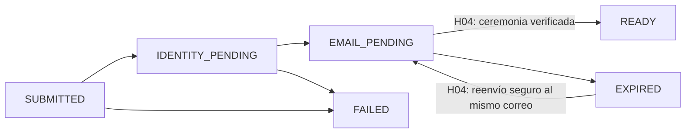

# Plan de ejecución — I1-H03 Registrar empresa y primer administrador

- Estado del plan: `APPROVED`.
- Aprobación expresa: Product Owner, 2026-11-02, en este chat.
- Commit del plan aprobado: `27b404c56b0d918e69c20b0319c6cc29daa92b89`.
- Alcance de la aprobación: el plan de ejecución; B0, P0, la entrada S0 de H03 y la concreción de ADR-003/007 permanecen pendientes. No cierra gates ni autoriza E1 u otras entregas.
- Fecha: 2026-11-02.
- Integración del plan aprobado: [PR #21](https://github.com/omarjtoscano/propractix-v2/pull/21), commit `b398694bf1a68b65c674efa579b9c468a207c464`, confirmada expresamente por el PO el 2026-11-02. Sus restricciones anteriores de Draft/sin merge y rama documental quedan sustituidas por esta autorización.
- Rama E1 histórica: `feature/i1-h03-e1-company-domain`; rama documental anterior: `docs/i1-h03-e1-entry-decisions`.
- Base actual E2: `increment/01-company-identity-catalog`, commit `7854d2f4bbb2d5d8fc1c21d3408431505c00b510`.
- Rama E2 actual: `feature/i1-h03-e2-company-onboarding-application`.
- H02: integrada mediante `f387f260acc0b32ed8a85373cf12d45476371ebe` y `DONE / ACCEPTED` localmente, confirmado expresamente por el Product Owner el 2026-11-02. Se conserva la [aceptación funcional y su evidencia](../reviews/aceptacion-i1-h02.md).
- Aprobación de entrada local E1: Product Owner, 2026-11-02, sobre `b097d0aced1764e88149fa618e598d8891c6b6cf`; decisiones de la sección 3.1 `APPROVED` para su alcance local, sin autorización de implementación en aquella aprobación ni cierre de gates.
- Integración de las decisiones de entrada local: [PR #22](https://github.com/omarjtoscano/propractix-v2/pull/22), commit `2e797ebfd5c22481ec0a21f4c0ca8d9933fffbbd`, confirmada expresamente por el PO el 2026-11-02.
- Autorización histórica de implementación del PO (2026-11-02, posterior a PR #22 y anterior a la aceptación E1): implementar y validar exclusivamente E1 localmente, dominio Java puro y JUnit con datos sintéticos y condiciones de entrada ya aprobadas; commit, push y Draft PR al incremento, sin merge. **H03 y E1 `IN_PROGRESS`, sin aceptación**; E2 y posteriores `NOT_AUTHORIZED / NOT_STARTED`. B0/P0/E0 y entrada S0 de H03 pendientes; S0 cerrado solo para H02, CL0 `PENDING`. Sin dependencia en `pom.xml`, normalizador técnico, aplicación/puertos/adapters, migraciones, DNS, HTTP/OpenAPI, frontend, provisioning, credenciales, recuperación, políticas publicadas, cambios funcionales H02 ni AWS. [Evidencia E1](../reviews/i1-h03-e1-domain-evidence.md).
- Aceptación E1 y autorización histórica (PO, 2026-11-07, anterior a su integración; sustituida por E2): E1 `ACCEPTED` por aprobación expresa del Product Owner el 2026-11-07 sobre `58c5a047708a5380ea6b8cecbbfc8c133b9f88d6`; H03 sigue `IN_PROGRESS` y E2/posteriores `NOT_AUTHORIZED / NOT_STARTED`. Solo se autoriza registrar la aceptación documental y actualizar el cuerpo de la misma Draft PR #23, con commit y push en `feature/i1-h03-e1-company-domain`. Sin código, nuevas suites funcionales, E2, merge ni cambios de gates. B0/P0/E0 y entrada S0 de H03 pendientes; S0 cerrado solo para H02, CL0 `PENDING`, sin AWS.
- Procedencia de la evidencia: La revisión técnica asistida por Codex en este chat (2026-11-07) y la regresión del locale son distintas de la aprobación del PO. CI, Trivy y Build OCI en verde sobre `58c5a047708a5380ea6b8cecbbfc8c133b9f88d6` según confirmación expresa del PO; no se atribuye esa comprobación al agente. Las suites locales anteriores (`server:test` y `server:verify`: 413 pruebas, 0 fallos, 0 errores y 1 benchmark omitido; 94 casos de dominio) se ejecutaron en un workspace que incluía dos ajustes de imports del PO en pruebas H02 fuera del commit/PR. Se conservan esos ajustes fuera de la PR. Los checks del nuevo SHA documental los verificará e informará el PO, sin espera ni supervisión del agente.

- Autorización vigente del Product Owner (2026-11-07): E1 sigue `ACCEPTED` e integrada mediante `e5c8461c124b284762b782f7a51c590e78b5fb6d` (PR #23); limpieza Jackson integrada mediante `7854d2f4bbb2d5d8fc1c21d3408431505c00b510` (PR #24), confirmadas expresamente por el PO. Se autoriza exclusivamente `I1-H03 E2 — Puertos y casos de uso con dobles` conforme al plan aprobado, en `feature/i1-h03-e2-company-onboarding-application`, desde `increment/01-company-identity-catalog` actualizada sobre `7854d2f4bbb2d5d8fc1c21d3408431505c00b510`. H03 y E2 `IN_PROGRESS`, sin aceptación de E2; E3 y posteriores `NOT_AUTHORIZED / NOT_STARTED`. Incluye submit tipado sin HTTP, puertos, aviso autoritativo mediante `ResolveApplicablePrivacyNotice`, contrato público `PrepareAdministratorAccount` sin implementación ni llamada síncrona desde submit, eventos mínimos versionados y pruebas con dobles exclusivamente sintéticos. Autorizados validación local, documentación, commit, push y Draft PR al incremento, sin merge. B0/P0/E0 y entrada S0 de H03 pendientes; S0 cerrado solo para H02, CL0 `PENDING`. Sin SQL/JPA, migraciones, relay, idempotencia durable, DNS real, ICU4J, HTTP/OpenAPI, frontend, credenciales, políticas publicadas ni AWS. La concreción ADR-003/007 sigue pendiente antes de E5. CI, Trivy y Build OCI los verificará e informará el PO, sin espera ni supervisión del agente. Evidencia: [E2](../reviews/i1-h03-e2-application-evidence.md).

## 1. Fuentes y límites de la propuesta

Orden de autoridad consultado: [especificación técnica](../ProPractix-V2-MVP-Espana-Especificacion-Arquitectura-y-Tecnica-para-Codex.md), [blueprint de dominio](../ProPractix-V2-Blueprint-Dominio-y-Mapas-Legales-Espana.md), ADR aceptados y [contrato de H03 del plan aprobado, revisión 7](increment-01-plan.md#i1-h03--registrar-empresa-y-primer-administrador). Este documento descompone ese contrato; no sustituye los ADR ni aprueba políticas.

| Fuente | Aplicación en H03 |
|---|---|
| [ADR-001](../adr/ADR-001-monolito-modular.md), [ADR-002](../adr/ADR-002-arquitectura-hexagonal-paquetes.md) | Monolito modular, proceso propietario de `organization`, contratos públicos y transacciones separadas. Baseline F0 y generador aislado conservados. |
| [ADR-003](../adr/ADR-003-multitenancy-tenant-context.md) | Cuenta global, convergencia segura, tenant generado, `COMPANY_OWNER`, duplicado fiscal y rotación HMAC. |
| [ADR-004](../adr/ADR-004-identificadores-tiempo-concurrencia.md) | UUID v4, `Instant`, reloj sustituible, versión y claims atómicos PostgreSQL. |
| [ADR-005](../adr/ADR-005-eventos-outbox.md) | Outbox, deduplicación, leases, recuperación y mensajes durables sin PII ni secretos. |
| [ADR-006](../adr/ADR-006-dominio-jpa-propiedad-tablas.md) | Propiedad de tablas, dominio/JPA separados, PII cifrada y aviso autoritativo. |
| [ADR-007](../adr/ADR-007-autenticacion-sesiones-csrf.md), [ADR-008](../adr/ADR-008-openapi-errores-idempotencia.md) | Alta sin contraseña, no enumeración, rate limiting, privacidad antes del body e idempotencia anónima. |
| [ADR-009](../adr/ADR-009-despliegue-cloud-incremental-aws.md), [ADR-012](../adr/ADR-012-desarrollo-local-y-adapters-aws.md) | Aceptación local sintética con PostgreSQL 16 y Mailpit, sin AWS. ADR-011 no requiere ejecución en H03. |
| [Revisión de correo V1](../reviews/revision-politica-correo-empresarial-v1.md), [seed existente](../policies/company-email-admission-seed-v1.yaml) | Punto de partida de B0; 84 dominios heredados, no política publicada. |
| [Decisión S0](s0-public-endpoints.md), [política vigente](../policies/public-endpoint-rate-limits-v1.yaml), [runbook](../operations/rate-limiting-runbook.md) | Reutilización del mecanismo de H02; su autorización solo cubre `searchAcademicInstitutions`. |

Los parámetros de las secciones 4–6 siguen como **propuestas** fuera del alcance local E1 aprobado expresamente en la sección 3.1; no se aprueban su publicación ni materialización por esta decisión. Si al detallarlos aparece contradicción con una fuente aprobada, se solicita decisión antes de implementar; no se resuelve silenciosamente.

## 2. Resultado, contrato e invariantes

El representante inicia el alta y recibe una respuesta genérica de solicitud recibida. Un caso nuevo válido alcanza `EMAIL_PENDING`; un fallo parcial conserva un estado recuperable. H03 no acredita control del correo ni existencia o representación de la empresa.

Contrato futuro, todavía sin modificar `docs/api/openapi.yaml`:

```text
POST /api/v1/company-onboardings
operationId propuesto: submitCompanyOnboarding
Idempotency-Key: UUID v4 aleatorio (al menos 128 bits)
request:
  legalName, tradeName?, registeredCountry,
  taxIdentifierType, taxIdentifier, timeZone, preferredLocale?,
  administratorName, administratorEmail,
  privacyNoticeReference { noticeId, version }
response: 202 { operationId: <UUID opaco> }
```

El `operationId` de respuesta identifica la solicitud técnica; no es el `operationId` estático de OpenAPI ni un ID de empresa/cuenta. No hay `Location` de un recurso consultable ni polling público. En casos de cuenta o empresa coincidente se conserva forma, status y headers seguros; no se informa cuál coincidió.

- H03 no recibe contraseña, roles, `tenantId`, estado, IDs de cuenta o memberships. Se propone rechazar propiedades desconocidas como entrada inválida, incluida la inyección de esos campos; nunca se usan como autoridad.
- `Company` inicia `SELF_DECLARED`; `TenantId` es su único identificador, generado por servidor. Cuenta nueva `PENDING_EMAIL` sin credencial. El rol inicial canónico es `COMPANY_OWNER`; no hay membership activa antes de la ceremonia de H04.
- Cuenta existente: no cambia credencial ni se enlaza por correo coincidente. Cuenta activa prepara `ONBOARDING_CONTINUATION`; cuenta `PENDING_EMAIL` sin credencial requiere la recuperación propuesta en la matriz siguiente, sin exigir una contraseña inexistente. Las ceremonias efectivas quedan para H04/H05 y la concreción pendiente de ADR. Ante empresa fiscal coincidente no se crea otro tenant ni se reclama el existente.
- El dominio exacto después de `@` se evalúa por política versionada. Dominio corporativo propio alojado en Google/Microsoft permitido. No se examina el proveedor MX para admitir empresas.
- `MAIL_CAPABLE`, `NO_MAIL_ROUTE` e `INDETERMINATE` son resultados técnicos. Los dos últimos conservan el alta y programan reintento; nunca rechazan ni activan una cuenta. El `UNKNOWN` de cumplimiento sigue bloqueando puertas legales.
- País registral, locale y jurisdicción son distintos. País habilitado y locale/fallback se resuelven desde configuración tipada; estrategias fiscales por país/tipo fuera de `Company`. Un país puede conservarse aunque su jurisdicción no esté soportada; nunca se aplica un fallback jurídico español.
- [i18n existente](../development/i18n-and-errors.md): ES/EN completos, `ErrorMessage` por código y fallback genérico traducido; no se muestran `Error.message`, `title`, `detail` ni prosa de violations. Textos legales versionados por separado.

### Matriz propuesta de PrepareAdministratorAccount y recuperación futura

`identity` distingue internamente los siguientes casos para un **nuevo** `OnboardingId`. Los nombres de resultado son propuestas de contrato tipado; solo salen IDs y el código necesario por el contrato/evento interno autorizado, nunca estado de credencial, correo o información de existencia por HTTP. Todos conservan el mismo `202` público genérico.

| Cuenta al preparar | Resultado interno propuesto de `PrepareAdministratorAccount` | Efecto permitido en H03 | Ceremonia futura, fuera de H03 |
|---|---|---|---|
| No existe | `NEW_ACCOUNT_PREPARED` con `OnboardingId` y `UserId` generado por `identity`. | Crear una sola cuenta `PENDING_EMAIL` sin credencial; intención `INITIAL_CREDENTIAL_SETUP`. `organization` puede crear la empresa candidata `SELF_DECLARED` conforme a unicidad fiscal; no activa membership. | H04 verifica el enlace de propósito `INITIAL_CREDENTIAL_SETUP` y crea la primera credencial directamente en `identity`; no se pide una contraseña anterior. |
| Existe `PENDING_EMAIL` sin credencial | `PENDING_ACCOUNT_RECOVERY_REQUIRED` con `OnboardingId` y referencia interna a la cuenta existente. | Reutilizar la cuenta sin duplicarla, sin crear credencial ni sobrescribir datos del alta original. Mantener una intención recuperable; el nuevo onboarding no crea empresa ni membership por coincidencia. No se exige login/reautenticación con contraseña. | Recuperar o reemitir de forma controlada una verificación `INITIAL_CREDENTIAL_SETUP` para **esa cuenta pendiente y el mismo correo registrado**. Tras consumirla una sola vez y crear la primera credencial, autenticar y confirmar por separado la continuación del nuevo onboarding; `ONBOARDING_CONTINUATION` no crea ni sustituye contraseñas. |
| Existe `ACTIVE` con credencial | `ACCOUNT_CONTINUATION_REQUIRED` con `OnboardingId` y referencia interna a la cuenta existente. | Mantener intención `ONBOARDING_CONTINUATION`, sin modificar credencial, crear empresa ni enlazar membership automáticamente. | Actor no autenticado: enlace de continuación y autenticación; actor autenticado: reautenticación antes de vincular. Nunca reutilizar este flujo para sustituir una credencial. |

Repetir el **mismo** `OnboardingId` reproduce el resultado durable original y los mismos IDs: si aquella llamada creó la cuenta, su retry no se reclasifica como recuperación de cuenta pendiente ni vuelve a crear empresa. Dos onboardings distintos concurrentes para un email producen a lo sumo una cuenta nueva; el otro obtiene recuperación pendiente o continuación según el estado autoritativo de `identity`. Estados suspendidos/cerrados o combinaciones inconsistentes no se degradan a «cuenta nueva»; quedan sin provisioning automático ni revelación pública.

La recuperación futura de una cuenta pendiente exige demostrar control del correo mediante el enlace válido, comprobar estado y ausencia de credencial al consumirlo, expiración/invalidación de enlaces anteriores y consumo/creación de la primera credencial atómicos. Si otra operación ya activó la cuenta, se abandona el alta inicial de credencial y se exige la continuación autenticada propia de la cuenta activa; nunca se sobrescribe el hash. Recuperar la cuenta no aprueba automáticamente otro onboarding ni transfiere empresas/memberships; la nueva vinculación exige confirmación verificada/autenticada y comprobación fiscal. Cuenta eliminada por retención no se recupera mediante un token antiguo.

**Decisión pendiente, no modificación de ADR:** [ADR-003, convergencia de cuenta](../adr/ADR-003-multitenancy-tenant-context.md#convergencia-de-cuenta) y [ADR-007, credenciales](../adr/ADR-007-autenticacion-sesiones-csrf.md#credenciales) formulan la continuación de «cuenta existente» sin separar explícitamente la pendiente sin credencial. La rama de recuperación anterior es una propuesta concreta de esa separación y debe quedar aceptada expresamente por Producto + Seguridad + Arquitectura mediante concreción/revisión de ADR-003/007 **antes de implementar esa rama de E5 o su ceremonia en H04**. Esta PR no modifica esos ADR, autoriza la ceremonia ni convierte `ONBOARDING_CONTINUATION` en permiso de alta de contraseña. E5 solo planifica el resultado/intención y sus pruebas con dobles; emisión, reenvío, consumo, autenticación y recuperación efectiva pertenecen a H04/H05.

## 3. Gates y decisiones que requieren aprobación

| Elemento | Estado conservado | Decisión/evidencia pendiente y owner |
|---|---|---|
| H01 y H02 | `DONE / ACCEPTED` localmente | Ninguna reimplementación. Integración H02 registrada sobre `f387f260acc0b32ed8a85373cf12d45476371ebe`. |
| D0 / F0 / C0 | `CLOSED` | No se reabren ni modifican. |
| `B0_COMPANY_EMAIL_POLICY` | `PENDING` | Normalización, IDNA y política tipada aprobados por el PO para entrada local E1 en sección 3.1. Producto + Seguridad aún deben cerrar cobertura, versión/publicación, parámetros posteriores y evidencia de carga/actualización/rollback y pruebas de sección 4. |
| `P0_PRIVACY` | `PENDING` | Producto + Privacidad/Legal + Seguridad: ML-15, aviso real, datos, finalidad, base jurídica, derechos y retención. La propuesta sintética no lo cierra. |
| `S0_PUBLIC_ENDPOINTS` | `CLOSED`, exclusivo H02 | Seguridad + Operaciones: aprobar entrada propia `submitCompanyOnboarding`, sujetos, ventanas, TTL, rotación y pruebas. La nueva entrada está **pendiente**, no autorizada por S0 cerrado. |
| `E0_EMAIL` | `PENDING` | Correo real y entrega de verificación pertenecen a H04 y a su aprobación separada. |
| `CL0_CLOUD_STAGING` | `PENDING`, sin cambios | Sin AWS, IaC, promoción, exposición pública ni cierre cloud. |
| Este plan | `APPROVED` | Aprobación expresa del PO el 2026-11-02 sobre `27b404c56b0d918e69c20b0319c6cc29daa92b89`. Las propuestas expresamente pendientes conservan su estado; no cierra gates ni autoriza E1 u otras entregas. |
| Cuenta pendiente sin credencial | Propuesta pendiente de decisión | Producto + Seguridad + Arquitectura: aceptar expresamente la matriz y concretar ADR-003/007 antes de implementar su rama de E5; sin recuperación efectiva ni implementación H04 en esta PR. |
| Decisiones de entrada local E1 | `APPROVED` | PO, 2026-11-02, sobre `b097d0aced1764e88149fa618e598d8891c6b6cf`; solo contrato/IDNA, política tipada, `P7D` de pruebas, condiciones sintéticas y validación local S0 de sección 3.1. No autoriza ejecución ni cierra gates. |
| E1 / E2 / demás entregas | E1 `ACCEPTED`; H03/E2 `IN_PROGRESS`; E3+ `NOT_AUTHORIZED / NOT_STARTED` | PO confirma E1 integrada por `e5c8461c124b284762b782f7a51c590e78b5fb6d` y autoriza exclusivamente E2 el 2026-11-07; sin cierre de gates ni aceptación E2. |

Las decisiones de entrada local E1 quedan aprobadas con el alcance de la sección 3.1; la autorización separada de implementación local fue concedida por el PO el 2026-11-02 tras PR #22. La revisión de B0 exige pruebas: la aprobación de decisiones de entrada local se distingue de la autorización de implementación y del cierre posterior con evidencia. **No se da B0 por cerrado para romper esa dependencia**: cualquier autorización local condicionada debe ser expresa, y el endpoint permanece deshabilitado hasta satisfacer sus condiciones. La autorización inicial se limitó a E1 local; la autorización vigente amplía exclusivamente a E2 con dobles, sin habilitar el endpoint.

P0 permite trabajar únicamente con fixtures sintéticas de local/test según ADR-012; no habilita datos reales. La [fixture de staging](../policies/staging-synthetic-privacy-fixture-v1.yaml) permanece exclusiva de staging: no se reutiliza cambiando su scope. Las condiciones de una fixture local distinta están aprobadas en la sección 3.1; su materialización y textos/hash requieren aprobación posterior. Debe rechazar procedencia desconocida y no simular aprobación jurídica. Producción falla cerrada sin aviso real `APPROVED` vigente.

### 3.1 Decisiones de entrada de E1 — decisiones locales aprobadas

**Decisiones de entrada local `APPROVED` por aprobación expresa del PO el 2026-11-02 sobre `b097d0aced1764e88149fa618e598d8891c6b6cf`. Esta aprobación documental no autorizaba por sí sola implementar E1; la autorización posterior figura al final de esta sección.** Comprende contrato de normalización con sensibilidad del local-part, perfil/opciones/vectores IDNA, política suministrada mediante valores tipados, expiración `P7D` para pruebas E1, condiciones sintéticas `LOCAL_TEST / TEST_ONLY` y validación local S0 sin habilitar H03 ni alterar H02. La autorización documental histórica solo permitía registrar esta aprobación y actualizar ADR-001, referencias y cuerpo de la misma PR #22, con commit/push. No cierra B0/P0/E0 ni la entrada S0 de H03; CL0 sigue `PENDING`. Reutiliza las propuestas de las secciones [4](#4-propuesta-b0-política-y-comprobación-técnica-de-correo), [5](#5-propuesta-p0-minimización-aviso-y-retención) y [6](#6-propuesta-de-entrada-de-rate-limiting-de-h03).

**B0 — decisiones de entrada E1 aprobadas por el PO; gate `PENDING`.** Contrato único de normalización aprobado para el alcance local: retirar solo espacios exteriores U+0020, rechazar controles/espacios interiores y exigir una sola `@`; local-part ASCII de tipo dot-atom, conservando mayúsculas, puntos y `+`, sin alias específicos de proveedor. Dominio a minúsculas y forma IDNA canónica; comparación exacta, sin wildcards, herencia a subdominios ni inspección de MX. Límites aprobados para E1 tras canonicalizar: local-part 1–64 octetos, etiquetas de dominio 1–63, dominio hasta 253 y dirección completa hasta 254; sin punto final, etiquetas vacías, literales IP, comentarios, comillas ni SMTPUTF8 en local-part. Son límites sintácticos tipados, no parámetros libres de la política.

El contrato, incluida la sensibilidad a mayúsculas del local-part, y **el perfil IDNA siguiente están aprobados para entrada local E1**. La política se suministra al dominio como valor tipado e inmutable con ID/versión y dominios canonicalizados; sin YAML/entorno, loader ni listas incrustadas. E1 usa fixtures sintéticas en memoria; el seed sigue `DRAFT`.

**IDNA — aprobado por el PO sobre `b097d0aced1764e88149fa618e598d8891c6b6cf` (contraste oficial: 2026-11-02).** Perfil: [UTS #46, revisión estable 35 / Unicode 17.0.0, secciones 4–4.2](https://www.unicode.org/reports/tr46/tr46-35.html), procesamiento **no transicional**: mapping UTS #46 → NFC → validación → ToASCII/Punycode. Opciones: `Transitional_Processing=false`, `UseSTD3ASCIIRules=true`, `CheckHyphens=true`, `CheckBidi=true`, `CheckJoiners=true`, `VerifyDnsLength=true`, `IgnoreInvalidPunycode=false`; además, comprobar `CONTEXTO` como restricción explícita adicional. No se hace case folding/NFKC independiente antes o después: el mapping y NFC pertenecen a la misma versión Unicode del algoritmo; `ß` no se transforma en `ss`.

Implementación fijada documentalmente, todavía sin incorporar: `com.ibm.icu:icu4j:78.3`, sin rangos ni actualización automática. La [documentación oficial de ICU 78](https://unicode-org.github.io/icu/download/78.html) identifica Unicode 17 y compatibilidad Java 11–25, incluido Java 21 de la baseline. API: `com.ibm.icu.text.IDNA.getUTS46Instance` con `USE_STD3_RULES | CHECK_BIDI | CHECK_CONTEXTJ | CHECK_CONTEXTO | NONTRANSITIONAL_TO_ASCII | NONTRANSITIONAL_TO_UNICODE` (máscara `0x7E`), sin otros flags. La [API en el tag oficial 78.3](https://github.com/unicode-org/icu/blob/release-78.3/icu4j/main/core/src/main/java/com/ibm/icu/text/IDNA.java) fija esos valores; se invoca `nameToASCII` sobre el dominio completo y se rechaza **cualquier** `Info.hasErrors()`, aunque haya salida parcial. No usar `java.net.IDN` como alternativa: [Java 21 documenta RFC 3490/Nameprep y Unicode 3.2](https://docs.oracle.com/en/java/javase/21/docs/api/java.base/java/net/IDN.html), otro perfil.

Secuencia aprobada para validación local: aplicar primero la sintaxis de dirección anterior; procesar solo el dominio con ICU, sin depender del locale del proceso. El resultado válido debe ser ASCII en minúsculas; comprobar etiquetas 1–63 octetos, dominio 1–253, dirección hasta 254 y ausencia de etiqueta vacía/punto final **también después del mapping**. Los separadores U+3002/U+FF0E/U+FF61 se mapean a U+002E según UTS #46. Exigir round-trip del dominio ASCII canónico: `nameToASCII(nameToUnicode(canon)) == canon`, con `Info` independiente y sin errores en ambas operaciones. Nunca reparar una A-label inválida, usar su salida parcial ni continuar con el input original. El local-part mantiene exactamente el contrato ASCII aprobado, case, puntos y `+`; NFC/IDNA no se aplican a él.

**Registro arquitectónico autorizado:** el PO autoriza actualizar [ADR-001, revisión 5](../adr/ADR-001-monolito-modular.md#normalización-técnica-de-correo-e-idna) para fijar ICU4J 78.3, perfil y fronteras. La capacidad técnica queda fuera de `domain`, detrás de puertos de aplicación y conectada por `configuration`, conforme a [ADR-002](../adr/ADR-002-arquitectura-hexagonal-paquetes.md). El dominio conserva valores ASCII canónicos validados, sin importar ICU ni dominios internos de otro contexto; no se introduce una excepción al dominio Java puro. Esta autorización solo materializa la decisión documental: no añade ICU4J a `pom.xml` ni instala dependencias ni implementa la capacidad técnica. No acredita pruebas de integración con la baseline.

**Contrato común futuro:** admisión empresarial, unicidad/comparación en `identity` y fingerprint de dirección deberán consumir **la misma normalización versionada y los mismos vectores**, mediante esa capacidad técnica, sin tres algoritmos propios ni normalización autoritativa en frontend. La admisión compara el dominio ASCII exacto; las entradas de política se canonicalizan con el mismo perfil antes de suministrarlas al dominio. Identidad usa la dirección canónica completa; el HMAC de dirección recibe sus bytes UTF-8, conservando case/puntos/`+` del local-part. Equivalentes Unicode/A-label del dominio producen la misma dirección y material de fingerprint; `faß`/`fass` permanecen distintos. Se mantienen claves/separadores HMAC propios de cada finalidad, sin compartir fingerprints entre finalidades ni alterar H02. Cambiar perfil, opciones o datos Unicode exigirá nueva decisión, análisis de colisiones/unicidad y transición de fingerprints sin reset permisivo de cuotas; no recanonicalización silenciosa.

| Vectores aprobados del contrato (E1 canónico; transformaciones Unicode en adapter futuro) | Resultado esperado aprobado |
|---|---|
| ` Persona+qa@EMPRESA.TEST ` | `Persona+qa@empresa.test`; conservar `+` y case del local-part. `persona+qa` sigue siendo otra dirección según el contrato aprobado. |
| `persona@bloqueado.test`; dominio incluido solo en la fixture suministrada | Rechazar por coincidencia exacta; sustituir la fixture cambia el resultado sin modificar el aggregate. |
| `persona@no-bloqueado.test`, `persona@sub.bloqueado.test` | No coinciden con `bloqueado.test`; sin bloqueo por substring o subdominio. |
| `persona@empresa.test`, suponiendo hosting Google/Microsoft | Admisión idéntica, independiente del hosting; E1 no consulta DNS. |
| `persona@bücher.test` (U+00FC) / `persona@bu\u0308cher.test` (U+0075 U+0308; escape descriptivo, no barra literal) / `persona@XN--BCHER-KVA.TEST` | Las tres producen `persona@xn--bcher-kva.test`; NFC compuesto/descompuesto y A-label válida son equivalentes. Mismos bytes para identidad y HMAC. |
| `persona@faß.test` / `persona@xn--fa-hia.test`; `persona@fass.test` | Las dos primeras producen `persona@xn--fa-hia.test`; la última permanece `persona@fass.test`. Dominios/direcciones distintos, sin colapsar `ß` a `ss`. |
| `persona@xn--.test`, `persona@xn--0.test`, `persona@xn--a.test`, `persona@xn--u-ccb.test` | Rechazar: payload vacío, Punycode inválido, U+0080 no permitido y secuencia decodificada `u` + U+0308 no NFC, respectivamente. No convertir la última en `xn--tda.test` para aceptarla. |
| Vacío, sin local/dominio, dos `@`, CR/LF/TAB, espacios interiores, puntos consecutivos o finales, local Unicode, A-label inválida | Rechazo sintáctico; no reinterpretación permisiva ni consulta de política sobre una dirección inválida. |
| Local 64/65, etiqueta 63/64, dominio 253/254, dirección 254/255 octetos | Aceptar el límite solo si cumple los demás; rechazar el exceso. Medir después de IDNA y combinar límites, no validar cada uno aisladamente. |
| Política no suministrada/inválida; tres resultados técnicos de ruta | Sin admisión permisiva por lista vacía; `MAIL_CAPABLE`, `NO_MAIL_ROUTE` e `INDETERMINATE` separados, sin activar cuenta ni rechazar por los dos últimos. |

Estos resultados IDNA son vectores aprobados del contrato, deducidos del perfil y de los ejemplos oficiales de UTS #46; no son resultados de una implementación ejecutada. La autorización E1 verifica únicamente invariantes de valores ASCII canónicos; ejecutar los vectores del motor exige la futura entrega autorizada del adapter.

Cobertura de los 84 dominios, hash final, aprobadores, vigencia, publicación y evidencia de carga/actualización/rollback siguen pendientes para cerrar B0. La autorización condicionada concedida para E1 permite pruebas puras antes de ese cierre. La expiración `P7D` queda aprobada para las pruebas E1; los parámetros técnicos posteriores siguen propuestos en la sección 4.

**P0 local — condiciones sintéticas aprobadas por el PO; gate real `PENDING`.** Reutilizar la ficha de la sección 5: `local-synthetic-company-onboarding`, versión candidata `2026-11-02.1`, finalidad `COMPANY_ONBOARDING`, scope `LOCAL_TEST`, estado `TEST_ONLY`. Datos exclusivamente sintéticos: nombres ficticios, correos `.test`/`.invalid`, fiscales generados para la ejecución; rechazar procedencia desconocida y copias reales, anonimizadas o de producción. Limpieza tras cada ejecución, máximo `P7D`, incluidas copias/artefactos; sin DNS público, correo externo ni promoción a staging/producción. Fixture separada de `STAGING_ONLY`, que permanece intacta. Estas condiciones locales están aprobadas; textos ES/EN y hash deberán aprobarse antes de materializar la fixture en E3/E7A. E1 solo usa valores en memoria; P0 real sigue `PENDING`.

**S0 local — condiciones de validación local aprobadas por el PO; entrada H03 pendiente.** Se conservan para validación local los valores de sección 6: IP 5/`PT1M` y 20/`PT1H`, dirección HMAC 3/`PT1H`, TTL `PT2M`/`PT61M`/`PT61M`, doble etapa y fail-closed. E1 no implementa limitador ni habilita `submitCompanyOnboarding`, siquiera por HTTP local. Una futura validación autorizada usa loopback, datos sintéticos y prueba continuidad H02: versión efectiva `1`, mismas claves/buckets, 15/`PT10S`, 60/`PT60S` y TTL `PT70S`/`PT120S`; ampliación documental y rollback nunca reinician cuotas. Faltan aprobación de la entrada/formato y evidencia posterior E7B; S0 sigue cerrado exclusivamente para H02, sin modificar su YAML ni su comportamiento.

**Autorización histórica local condicionada — concedida exclusivamente para E1 (PO, 2026-11-02, anterior a la aceptación del 2026-11-07).** Tras confirmar PR #22 / `2e797ebfd5c22481ec0a21f4c0ca8d9933fffbbd`, el PO autoriza dominio Java puro y pruebas JUnit, con datos sintéticos en memoria, desde el incremento actualizado en `feature/i1-h03-e1-company-domain`, documentación de evidencia, commit/push y Draft PR. **H03/E1 `IN_PROGRESS`**; sin aceptación ni autorización de E2. Se conserva el alcance de sección 8; B0/P0/E0 y entrada S0 de H03 pendientes; CL0 `PENDING`. Sin aplicación, puertos, adapters, BD/migraciones, loaders/publicación, endpoint, UI, provisioning ni recuperación. Concreción ADR-003/007 pendiente antes de E5.

**Frontera de conformidad E1/adapter:** E1 recibe valores ASCII canónicos y verifica sintaxis/límites, igualdad exacta y conservación del local-part; rechaza entradas Unicode/no canónicas sin transformarlas. No implementa trimming, mapping, NFC, ToASCII, decodificación Punycode ni round-trip. Las pruebas del motor Unicode/ICU y los vectores de transformación/rechazo de A-label por su contenido decodificado corresponden a la entrega futura del adapter, con ICU4J 78.3 y perfil de ADR-001; no se presentan fixtures ASCII o dobles como conformidad ejecutada del motor IDNA. La validación estructural del dominio presupone esa validación técnica previa, sin importar ICU ni `java.net.IDN` ni modificar `pom.xml`.

## 4. Propuesta B0: política y comprobación técnica de correo

Se reutilizan la revisión ya completada y el seed `company-email-admission`, versión `2026-09-12.1`, que conserva `DRAFT`, su fuente V1 y el hash del original `6e33c1d8dcd825a3a895dd2379e7181e9e63aebd6619bbf294d886a5ba213c7e`. No se repite la auditoría V1 ni se copia su implementación.

Propuesta para una futura versión inicial: `policyId=company-email-admission`, versión candidata `2026-11-02.1`, scope `COMPANY_SELF_REGISTRATION`. Se parte de sus 45 entradas `PUBLIC_OR_COMMON_PROVIDER` y 39 `DISPOSABLE_PROVIDER`, sujetas a revisión individual de cobertura y actualidad por Producto + Seguridad. No se afirma que estén verificadas hoy. No se añaden sufijos educativos ni wildcards; `.edu` y similares siguen excluidos como reglas implícitas.

La ficha a aprobar incluirá versión/esquema, fuente, hash SHA-256 del artefacto final, aprobadores, instante efectivo UTC y estados. No se asignan aprobadores ni fecha efectiva ficticios. Exactamente una versión publicada/vigente será seleccionable. Carga tipada inválida, ausente o ambigua deja H03 cerrado y responde `503 company_email_policy_unavailable` si se intenta usarlo; nunca hay lista vacía permisiva.

Para entrada local E1 rige el contrato de normalización, límites y vectores aprobado expresamente en la [sección 3.1](#31-decisiones-de-entrada-de-e1--decisiones-locales-aprobadas), incluida la política suministrada al dominio y el perfil fijado en ADR-001. Esta aprobación no publica la política ni cierra B0. La UI no mantiene una segunda lista ni decide la admisión. Bloqueo: `400 company_email_domain_not_allowed` por código de campo ES/EN.

| Configuración técnica propuesta | Valor inicial sujeto a aprobación |
|---|---|
| Tiempo máximo por comprobación | `PT2S`; fallo/timeout se convierte en `INDETERMINATE`. |
| Caché de resultado positivo / sin ruta / indeterminado | `PT15M` / `PT1M` / `PT30S`; sin respuestas DNS completas persistidas. |
| Reintento durable | Backoff exponencial desde `PT1M`, máximo `PT1H`, jitter ±20 %, 8 reintentos además del intento inicial. |
| Agotamiento | Mantener pendiente de verificación; código técnico de agotamiento y alerta, sin rechazo del alta ni promoción a `MAIL_CAPABLE`. Expiración del onboarding `P7D`. |
| Evidencia | Resultado, instante, próximo intento, contador y código técnico acotado; sin IP, email, dominio en claro ni respuesta DNS en logs/métricas. |

El adapter contempla MX y la ruta implícita admisible según protocolo; ausencia concluyente produce `NO_MAIL_ROUTE`, no una excepción de validación. Los tres resultados se prueban con resolver determinista. En local no se consulta DNS público ni se envía correo externo. Una futura verificación efectiva de enlace en H04 resuelve la comprobación pendiente para ese onboarding.

Actualización/rollback propuestos: artefactos inmutables, diff de dominios/categorías, nueva revisión, hash, aprobación e instante de activación; rollback mediante **otra versión** auditada con el contenido conocido, sin mutar la publicada. Ensayo local de carga, cambio, rechazo de versión inválida y recuperación; conservar versión evaluada en el onboarding. Nada de ello publica una política en esta PR.

## 5. Propuesta P0: minimización, aviso y retención

Finalidad candidata: `COMPANY_ONBOARDING`, separada de marketing, candidaturas y comunicaciones universitarias. La jurisdicción del aviso se resuelve por configuración explícita para esa finalidad y ámbito; no se deduce del idioma ni se fuerza España por fallback. País sin cobertura de aviso configurada produce indisponibilidad, no selección de otro aviso.

Propuesta local: `noticeId=local-synthetic-company-onboarding`, versión candidata `2026-11-02.1`, scope exclusivo `LOCAL_TEST`, estado `TEST_ONLY`. Debe acompañarse de textos ES/EN identificados como sintéticos, hash y finalidad técnica; solo el perfil local/test acepta este tipo de fixture. No se marca `APPROVED` de datos reales. Para producción quedan pendientes responsable/contacto, base jurídica validada, destinatarios/encargados, transferencias, derechos, contacto y plazos de respuesta, retención y textos jurídicos reales; Privacidad/Legal debe resolverlos expresamente.

| Datos y propietario | Necesidad propuesta y protección |
|---|---|
| Nombre legal/comercial, país, tipo/valor fiscal, zona y locale — `organization` | Alta y configuración; fiscal normalizado cifrado más blind indexes HMAC de claves independientes. Sin prueba de existencia legal. |
| Nombre/email de administrador en proceso — `organization` | Provisioning transitorio; PII mínima cifrada en el process manager, sin copias en eventos. |
| Cuenta/email normalizado — `identity` | Cuenta global pendiente sin credencial; acceso únicamente por sus puertos. No duplicar datos de empresa. |
| Aviso y evidencia — `compliance` / onboarding propietario | Resolver aviso por finalidad, jurisdicción e instante del servidor. Persistir ID/versión autoritativos, hash del texto, instante de resolución/recepción y evidencia mínima; no inventar prueba de lectura ni confiar en timestamp del cliente. |
| Idempotencia / outbox / auditoría / limitador — propietarios `platform.*` | Metadatos mínimos y fingerprints específicos por finalidad; no body, email/IP/fiscal en claro, contraseñas o tokens. Pseudonimización no equivale a anonimato. |

Propuesta de retención para revisión, **sin valor jurídico aprobado ni aplicación en esta PR**:

| Categoría | Plazo candidato y acción |
|---|---|
| Onboarding no completado y PII de provisioning | Expira a `P7D` desde submit; limpieza diaria borra/redacta PII dentro de las siguientes 24 h, incluidas copias de retry/caché. |
| Onboarding completado en H04 | Redactar PII transitoria dentro de 24 h desde `READY`; conservar solo evidencia mínima y referencias necesarias según plazo aprobado. |
| Cuenta pendiente sin otros usos legítimos / empresa provisional no vinculada | Supresión candidata tras 7 días y 24 h de limpieza; nunca borrar una cuenta global usada por otro perfil ni una empresa ajena coincidente. |
| Cuenta y empresa en uso después de H04 | Conservar solo mientras exista relación; propuesta de supresión a los 30 días del cierre, sujeta a obligaciones/retenciones que debe fijar Legal antes de datos reales. |
| Idempotencia | TTL lógico `PT24H` de ADR-008; borrado físico en el siguiente lote horario. |
| Outbox e inbox | Tras terminal, redactar payload dentro de 24 h; metadatos/deduplicación 7 días. No borrar deduplicación antes del horizonte de replay/reproceso; después se prohíbe replay sin nueva decisión. |
| Evidencia del aviso y auditoría mínima | Candidato 30 días tras cierre/expiración, sin PII libre; aprobación Legal pendiente. Limpieza debe coordinarse con derechos y bloqueo legal autorizado. |
| Rate limiting | TTL de la sección 6; limpieza cada minuto, sin conservación adicional por incidente. |
| Dataset local, Mailpit, artefactos y copias de pruebas | Borrado tras cada ejecución; máximo 7 días en local, sin exportación ni restauración en producción. |

La cadencia diaria se acelera mediante reloj controlado en pruebas. Se comprobará supresión en tablas, copias, logs y artefactos; el runbook identifica responsables y ejecución de derechos sin crear ahora un endpoint administrativo. Los periodos de copia y recuperación no pueden reintroducir datos suprimidos. Términos, información de privacidad y consentimientos opcionales quedan separados; no se añade marketing ni una casilla genérica que pretenda resolver la base jurídica.

Secuencia obligatoria de privacidad:

1. Guard previo al binding: sin aviso aplicable vigente, `503 privacy_policy_unavailable`, sin deserializar body, registrar PII ni crear idempotencia derivada de él.
2. Tras binding y validación sintáctica, `organization` llama a `compliance.application.port.in.ResolveApplicablePrivacyNotice`. Coincidencia exacta de `noticeId/version` antes de claim o escritura personal. Aviso sustituido/manipulado/de otra finalidad: `409 privacy_notice_changed`; ausencia/expiración sin aviso vigente: `503 privacy_policy_unavailable`.
3. Persistir solo evidencia de la resolución del servidor. Una carrera de sustitución antes de esa resolución nunca guarda la referencia antigua como verdad.
4. La UI descarta confirmación anterior, vuelve a presentar la versión vigente y exige confirmación explícita. No reenvía automáticamente un submit bajo un aviso nuevo.

Propuesta de entrega del aviso sin endpoint adicional: recurso legal ES/EN versionado junto al cliente, procedente del mismo manifiesto de publicación que usa `compliance`, con ID, versión, hash y vigencia; la validación backend sigue siendo autoritativa. Ante cambio, recargar el recurso y mantener el formulario bloqueado si sigue obsoleto. Producto + Privacidad + Frontend deben aprobar esta opción; si se requiere un GET dinámico, se presenta contrato y entrada S0 propios antes de incluirlo. No se añade silenciosamente otro endpoint a H03.

## 6. Propuesta de entrada de rate limiting de H03

Se propone `submitCompanyOnboarding`, `POST /api/v1/company-onboardings`, contrato `v1`, en una futura versión documental 2 de `public-endpoint-rate-limits`. La versión documental agrupa entradas; cada operación conserva una versión efectiva de política independiente para identificar sus contadores. El artefacto aprobado de H02 permanece inmutable. La ampliación incorporaría su entrada sin cambios y añadiría H03; requiere aprobación de Seguridad + Operaciones y registro expreso del PO antes de activación.

### Versionado por operación y continuidad de H02

| Documento/configuración | Operación | Versión efectiva para admisión y persistencia |
|---|---|---|
| Documento aprobado v1 actual | `searchAcademicInstitutions` | `1`, igual a la versión que hoy carga H02. |
| Documento ampliado v2 propuesto | `searchAcademicInstitutions` | **`1` conservada**; la ampliación no cambia su política efectiva. |
| Documento ampliado v2 propuesto | `submitCompanyOnboarding` | `1` inicial propuesta en su propio namespace de operación; pendiente de aprobación. |

Propuesta de representación: `documentVersion=2` para el conjunto y `operationPolicyVersion` explícita en cada entrada. El loader compatible de v1 resuelve su única entrada con versión efectiva `1`; el nuevo loader valida cada entrada y entrega a admisión su versión efectiva, no la del documento. La columna existente `platform_rate_limit_bucket.policy_version`, `RateLimitPolicy.version` y el label permitido `policy_version` representan esa **versión efectiva por operación**. La versión documental queda como metadato de configuración, fuera de la clave de cuota; no se cambia el significado de las filas v1 ni se actualiza el YAML aprobado en esta PR.

La clave lógica de H02 sigue siendo `(operation_id=searchAcademicInstitutions, policy_version=1, rule_id, hmac_key_version, subject_fingerprint, window_started_at)`. Se mantienen IDs de reglas `burst/sustained`, límites 15/10 s y 60/60 s, TTL 70/120 s, alineación temporal de ventanas, cálculo PostgreSQL, normalización IP, separador/material HMAC y versiones de clave activas. Activar la ampliación no borra, copia, reinicia ni renombra buckets, no recalcula su inicio/expiración, no cambia fingerprints y no crea un namespace H02 con versión `2`. Las peticiones nuevas continúan reclamando las **mismas filas**; H03 añade filas bajo su propio `operation_id`.

El cambio de configuración se valida completo antes de seleccionarlo. Durante un despliegue con instancias antiguas y nuevas, ambas resuelven H02 a la misma versión efectiva `1` y comparten la admisión PostgreSQL atómica. Volver al documento v1 deshabilita H03 pero conserva la cuota de H02; no ejecuta limpieza extraordinaria ni resetea contadores. Una entrada v2 ausente, ambigua o que cambie silenciosamente la semántica de H02 falla cerrada. No se combina esta ampliación con una rotación HMAC ni cambios de reglas H02: tales cambios requieren decisión y transición propias, con continuidad demostrada antes de activarse.

Esta separación y el formato futuro requieren aprobación de Seguridad + Operaciones y revisión de compatibilidad de S0; no es una política publicada ni un cambio ya implementado. Una mera subida de la versión global actual a `2` sería incompatible con la continuidad exigida porque abriría otra clave de contador.

| Sujeto/regla propuestos | Límite | Ventana fija | Primera rechazada | TTL lógico de fila |
|---|---:|---|---:|---|
| IP HMAC / `registration_burst` | 5 | `PT1M` | 6 | `PT2M` |
| IP HMAC / `registration_sustained` | 20 | `PT1H` | 21 | `PT61M` |
| Email normalizado HMAC / `registration_address` | 3 | `PT1H` | 4 | `PT61M` |

Las ventanas alineadas se calculan en servidor; no hay crédito extra ni cuota nueva al cambiar clave de idempotencia, campos, cuenta existente, locale o correlation ID. Dos ventanas adyacentes pueden admitir hasta el doble alrededor de su frontera: estos valores y el impacto de IP compartida/bloqueo dirigido de una dirección deben revisarse con tráfico sintético antes de aprobarlos. No se promete prevención total de abuso distribuido.

- IP: conservar normalización IPv4 `/32`, IPv6 `/64`, HMAC-SHA-256, versiones activas, secretos externos y saneamiento de proxies de S0. Clave por versión efectiva de política de la operación/operación/regla/versión HMAC/sujeto/ventana; nunca por versión documental del conjunto.
- Dirección: fingerprint del email normalizado sin consultar si existe cuenta, con clave independiente y separador propuesto `propractix:ratelimit-registration-email:v1`. Se calcula solo tras los guards de privacidad y validación; no se persiste email en claro. Limita tanto cuentas nuevas como existentes sin diferencias observables por su existencia.
- Prebinding: admisión IP protege incluso requests malformados. Después de privacidad/binding, admisión de dirección. Cada admisión reclama atómicamente sus reglas y todas las versiones activas; la etapa IP ya consumida no se revierte si la segunda etapa o la validación posterior rechaza. No se anuncia atomicidad conjunta entre etapas.
- Los retries idempotentes siguen sujetos a abuso; no evaden cuotas. `429 rate_limited` con `Retry-After` entero, techo hasta que todas las ventanas violadas permitan continuar, mínimo 1; `503 rate_limiter_unavailable` con `Retry-After: 1` ante caída/configuración/clave/IP no resoluble, sin invocar el alta.
- Limpieza por lotes cada `PT1M`, expiradas fuera de decisiones aunque no se hayan borrado. Mismos umbrales de incidencia: más de 10 000 expiradas o edad mayor de `PT15M`. La retención del fingerprint de dirección se incluye en P0, sin reutilización para otras finalidades.
- Rotación sin reset permisivo: lectura/escritura de todas las versiones activas, sin retirar la anterior antes de agotar su horizonte de ventanas/TTL y verificar cobertura. Ensayo con altas concurrentes y sin ampliar retención por investigar abuso.
- Reutilizar métricas, labels permitidos y umbrales del runbook S0, discriminando por `operation_id/policy_version/rule_id`; sin IP, email, dominio, fiscal, fingerprints, keys o correlation ID como labels. Aviso por 1 error/5 min; crítico por 5 errores/5 min o 2 min caído; abuso: 30 rechazos y 20 %/10 min, crítico 100 y 50 %/10 min. No hay bypass automático.

La implementación actual del loader de H02 acepta una sola operación y el sujeto actual es IP. Por tanto, esta propuesta requiere extensión explícita de carga/selección por operación y sujeto de dirección detrás de puertos, no una edición de YAML que se suponga compatible. Se validará la nueva versión sin relajar la versión 1 ni cambiar el comportamiento del catálogo.

Pruebas exigidas: límites 6/21/4 aislados con reloj, recuperación de ventanas, concurrencia PostgreSQL, doble etapa, IP compartida, rotación, TTL/limpieza, caída fail-closed, spoof de cabeceras vía Caddy y ausencia de PII. No hay endpoint `check-domain`, búsqueda de cuentas ni excepción para IDs de empresa del cliente.

## 7. Proceso durable, transacciones y propiedad



`NO_MAIL_ROUTE` e `INDETERMINATE` se guardan como estado técnico ortogonal, no como `FAILED`. Los fallos reintentables conservan estado y próximo intento; terminales producen `FAILED` con código no personal. TTL inicial de onboarding `P7D`; `READY`, reenvío y recuperación autenticada se diseñan aquí como frontera, pero se ejecutan en historias posteriores. Cambiar correo no es recuperación anónima.

| Paso futuro | Transacción/owner y efecto durable |
|---|---|
| Admitir solicitud | Guards/políticas y aviso autoritativo antes de claim. `platform.idempotency` reclama operación; creación de onboarding y solicitud outbox de `organization` debe tener vínculo atómico con ese claim o protocolo recuperable verificable. Se propone misma transacción de infraestructura para registro técnico + cambio de un único contexto de negocio; nunca escribir `identity` en ella. |
| Preparar administrador | Relay, mediante handler propietario de `organization`, carga PII cifrada y la proporciona solo en memoria a `identity.application.port.in.PrepareAdministratorAccount`. La transacción de `organization` ya terminó; `identity` confirma su propia transacción idempotente por `OnboardingId`. |
| Responder al provisioning | `AdministratorProvisionedV1` o resultado de fallo versionado tras commit, con el resultado tipado propuesto en la matriz de cuentas. Consumidor `organization` deduplica; cuenta pendiente existente conserva intención de recuperación sin contraseña y cuenta activa intención de continuación autenticada, sin crear empresa ni vínculo por coincidencia. Fallo mantiene estado recuperable. |
| Crear empresa para cuenta nueva pendiente | Solo con resultado interno de cuenta nueva, `organization` vuelve a comprobar fingerprints de todas las claves fiscales activas e inserta `Company SELF_DECLARED` y todos sus fingerprints en su propia transacción, avanzando a `EMAIL_PENDING` sin activar membership. Conflicto concurrente conserva resultado público genérico, sin otro tenant ni lectura cross-tenant de detalle. |
| Revisión técnica diferida | `EmailDomainRoutingRecheckRequested` con IDs; handler propietario carga el dominio solo en memoria. Backoff persistido y resultado mínimo; reinicio no pierde el trabajo. |
| Verificación futura | `EmailVerificationRequested` deja intención durable sin token. H04 prepara verificación/JWS y entrega mediante `identity` → `notifications`; este plan no implementa emisión, envío ni consumo del enlace. |

La evaluación fiscal preliminar no revela detalles y evita provisioning innecesario cuando ya se conoce una coincidencia; la comprobación e inserción final siguen siendo atómicas. El resultado interno nuevo/existente nunca se devuelve por HTTP. La posición de creación empresarial evita que una coincidencia de correo cree un tenant antes de la ceremonia segura.

El mensaje `AdministratorProvisioningRequested` lleva solo IDs y metadatos. `CompanyOnboardingSubmitted`, resultados y recheck se versionarán bajo `docs/events` al autorizar la entrega correspondiente; no son OpenAPI. Relay genérico `platform.outbox`, wiring en `configuration`; sin importaciones inversas de `platform` o `notifications` hacia `identity`. Deduplicación `consumer + event_id`, orden por aggregate/version, claim `FOR UPDATE SKIP LOCKED`, lease que expira, backoff/jitter y `DEAD_LETTER` observable, sin descarte ni replay administrativo público.

La recuperación debe cubrir caída tras claim de idempotencia, tras commit antes de relay, tras commit de `identity` antes del ack y tras consumo antes de confirmación. Un `PROCESSING` incierto no ejecuta el alta a ciegas: recupera por operación/onboarding durable; si no hay efecto confirmado, retoma bajo claim exclusivo. El `202` nunca afirma que el provisioning ya terminó.

Tablas previstas, solo cuando la entrega autorizada las necesite:

| Owner | Tablas / acceso |
|---|---|
| `organization` | `organization_company`, `organization_company_tax_fingerprint`, `organization_company_onboarding`; `organization_membership` solo si es necesaria para representar vínculo pendiente, nunca activa por coincidencia. Recursos tenant-owned filtrados por tenant en repositorios y SQL. |
| `identity` | `identity_user_account` pendiente; deduplicación del provisioning por onboarding mediante registro propietario documentado en la matriz antes de migrar. No credencial/refresh ni tabla de verificación vacía anticipada. |
| `compliance` | `compliance_privacy_notice`, consulta de aviso vigente; `organization` no escribe sus tablas. |
| `platform` | Outbox/inbox, idempotencia y auditoría mínima de ADR-006; reutilizar rate-limit buckets de H02. No tabla de notificaciones ni tabla `tenant` alternativa. |

UUID nativos, `timestamptz`, versiones `bigint`, JPA/mappers en adapters; fiscal cifrado y blind index con claves distintas. Unicidad global fiscal por `(registered_country, tax_identifier_type, key_version, fingerprint)`; insertar todas las versiones activas con la empresa. Rotación: doble lectura/escritura, backfill idempotente, cobertura verificada y retirada posterior. Los puertos de deduplicación fiscal tienen uso restringido, no lectura genérica entre tenants. Migraciones futuras forward-only y pruebas sobre PostgreSQL 16 vacío y actualización desde H02; ninguna migración se crea ahora.

## 8. Entregas propuestas y dependencias

E1 está `ACCEPTED` e integrada mediante `e5c8461c124b284762b782f7a51c590e78b5fb6d`, confirmado por el PO el 2026-11-07. H03/E2 `IN_PROGRESS`; E3 y posteriores `NOT_AUTHORIZED / NOT_STARTED`. Las ramas futuras se crearán desde el incremento actualizado, una por autorización; nombres `feature/i1-h03-eN-*`. Cada entrega aporta diff acotado, pruebas relevantes y evidencia, y se revisa/acepta antes de la siguiente. Los adapters HTTP finales llegan después del dominio; el contrato OpenAPI se diseña antes de implementar REST.

### E1 — Dominio empresarial e invariantes

- Estado: `ACCEPTED`; aprobación expresa PO 2026-11-07 sobre `58c5a047708a5380ea6b8cecbbfc8c133b9f88d6`, con CI, Trivy y Build OCI en verde confirmados por el PO. H03/E2 `IN_PROGRESS`. E1 integrada por PR #23 / `e5c8461c124b284762b782f7a51c590e78b5fb6d`, confirmado por el PO el 2026-11-07; [evidencia y procedencia](../reviews/i1-h03-e1-domain-evidence.md).
- Revisión/validación: técnica asistida por Codex y suites locales separadas de los checks remotos confirmados por el PO; el workspace local incluía dos ajustes de imports H02 fuera del commit/PR, conservados sin incluir. El nuevo SHA documental queda pendiente de checks del PO, sin supervisión del agente.

- Dependencias: plan aprobado, autorización expresa y decisiones de entrada de la sección 3, incluidas las decisiones locales aprobadas de la [sección 3.1](#31-decisiones-de-entrada-de-e1--decisiones-locales-aprobadas); la aprobación documental no sustituye la orden de implementación.
- Alcance: `Company`, `CompanyOnboarding`, IDs, estados, fiscal/country/locale/timezone, política pura de admisión y resultado técnico separado. Sin listas incrustadas ni frameworks en dominio.
- Aceptación/pruebas: transiciones válidas/ilegales, `SELF_DECLARED`, rol fijo, invariantes sobre ASCII canónico (motor IDNA en adapter futuro), cambio de configuración sin cambiar aggregate, locale/fallback sin jurisdicción implícita, tres resultados de ruta, reloj fijo y expiración `P7D`; JUnit sin Spring ni BD.
- Excluye: JPA, migraciones, DNS real, API, cuentas activas, H04 y UI.

### E2 — Puertos y casos de uso con dobles

- Estado: `IN_PROGRESS`, autorización expresa del PO el 2026-11-07; rama `feature/i1-h03-e2-company-onboarding-application`, base `7854d2f4bbb2d5d8fc1c21d3408431505c00b510`. E1 `ACCEPTED`; E3+ no autorizadas. [Evidencia E2](../reviews/i1-h03-e2-application-evidence.md).
- Concreción E2: submit queda `IDENTITY_PENDING`, sin crear tenant/cuenta/membership. El índice fiscal devuelve solo coincidencia booleana y retiene el caso para revisión sin reclamar la empresa. Toda cuenta se resuelve después del commit; el submit no consulta ni llama a `identity`. Contrato de provisioning sin implementación; la decisión pendiente de ADR-003/007 se mantiene para E5. `NO_MAIL_ROUTE` e `INDETERMINATE` dejan pendiente y encolan intención de recheck, sin relay ni scheduler. Unidad de trabajo abstracta para onboarding/outbox/auditoría; sus dobles no acreditan atomicidad SQL ni durabilidad.

- Dependencias: E1 aceptada.
- Alcance: submit, resolución autoritativa del aviso, repositorios tenant-aware, reloj/IDs, política, cifrado/fingerprints, DNS, outbox/auditoría y contrato público de provisioning. Fakes para fallos y concurrencia lógica; eventos mínimos versionados.
- Aceptación/pruebas: orden de guards antes de escritura, cuenta/empresa coincidente sin enlace, fallos recuperables, no contraseña ni PII en mensajes, aviso cambiado/manipulado/expirado/finalidad incorrecta y negativo cross-tenant. ArchUnit contra registro de ADR-001.
- Excluye: SQL, relay ejecutable, acceso a tablas de otros contextos, API pública y credenciales.

### E3 — Persistencia de organización, privacidad y protección fiscal

- Dependencias: E2 aceptada; diseño de tablas, claves y fixture local aprobado.
- Alcance: migraciones necesarias de `organization`/`compliance`, mappers, repositorios y evidencia autoritativa, PII cifrada, blind indexes multiversión, expiración/limpieza y ensayo de rotación/backfill. No alterar migraciones H02.
- Aceptación/pruebas: Testcontainers PostgreSQL 16 vacío/upgrade, rollback de transacción, cifrado y claves separadas, duplicado fiscal antes/durante/después de rotación y dos altas simultáneas; lecturas/escrituras/listados A/B negativos, optimistic locking y borrado de PII por estado/plazo.
- Excluye: publicación de políticas reales, migraciones futuras de credencial/sesión, claims administrativos y HTTP.

### E4 — Outbox e inbox recuperables

- Dependencias: E3 aceptada.
- Alcance: tablas técnicas necesarias, relay genérico, leasing, deduplicación, orden por aggregate, backoff/jitter, expiración y dead letters; contratos de eventos de H03 bajo `docs/events`.
- Aceptación/pruebas: commit sin entrega y reinicio, dos workers, lease expirado, entrega repetida sin duplicación, caída antes/después de ack, terminal/agotamiento observable y ausencia de PII/secretos. PostgreSQL concurrente y reloj controlado.
- Excluye: broker, Kafka, SMTP, JWS, notificaciones persistidas y replay administrativo sin autorización.

### E5 — Provisioning mínimo de identity y coordinación

- Dependencias: E4 aceptada y concreción expresa de ADR-003/007 para la rama de cuenta pendiente sin credencial antes de implementarla; la matriz propuesta no sustituye esa decisión.
- Alcance: `PrepareAdministratorAccount` idempotente por `OnboardingId`, tres resultados de la matriz de cuentas, intenciones de alta inicial/recuperación pendiente/continuación activa y handlers `organization` con PII transitoria. Registro propietario de deduplicación antes de su migración.
- Aceptación/pruebas: cuenta nueva → `NEW_ACCOUNT_PREPARED`, una cuenta `PENDING_EMAIL` sin credencial y caso nuevo hasta `EMAIL_PENDING`; cuenta pendiente sin credencial y otro onboarding → `PENDING_ACCOUNT_RECOVERY_REQUIRED`, misma cuenta, sin pedir contraseña/login ni crear empresa/vínculo; cuenta activa → `ACCOUNT_CONTINUATION_REQUIRED`, sin alterar credencial ni vincular. Con dobles, verificar que cada resultado deja la intención correcta para la ceremonia futura; reemitir/consumir enlaces o crear contraseña no forma parte de E5.
- Pruebas adicionales: retry del mismo onboarding reproduce resultado/IDs originales aunque la cuenta ya exista o haya cambiado de estado; onboardings distintos concurrentes con el mismo email crean a lo sumo una cuenta y no dos tenants por coincidencia; fallo parcial/reinicio/evento duplicado conserva intención y transacciones separadas. Mantener las pruebas de integración PostgreSQL del provisioning y su deduplicación; los dobles solo sustituyen las ceremonias futuras excluidas. Un doble de revalidación de la frontera futura que informa activación concurrente exige continuación autenticada, sin sobrescribir credencial ni reclasificar el resultado durable de un retry del mismo onboarding. La especificación de la frontera H04 exige pruebas futuras de enlace expirado/usado, doble consumo y cuenta ya activada, sin ejecutarlas ni acreditar H04 en E5.
- Excluye: autenticación/reautenticación efectiva, activación, contraseña, JWS, envío de enlace y endpoints de H04/H05. No se simula aceptación de esas historias con un fake en producción.

### E6 — Idempotencia anónima durable

- Dependencias: E5 aceptada.
- Alcance: `platform.idempotency`, claim atómico operación/clave, fingerprint HMAC-SHA-256 del comando validado canónico UTF-8/propiedades ordenadas, versión de contrato/método/ruta; estados y recuperación coordinada con submit/outbox.
- Aceptación/pruebas: TTL `PT24H`, primera petición única, misma clave/fingerprint terminal y `PROCESSING` con mismo `202`/ID, distinto fingerprint `409 idempotency_key_reused`, fallos antes de efecto replayables y estado incierto recuperado sin repetición. Testcontainers concurrente y crash en cada frontera. Sin body/contraseña/token/cookie persistidos.
- Excluye: idempotencia sobre contraseña, polling y almacenar respuestas con PII. Aviso inválido no crea registro derivado del body; cambiar correlation ID/orden JSON no cambia fingerprint.

### E7A — Carga de políticas y guards de privacidad

- Dependencias: E6 aceptada; decisiones B0 y fixture P0 local aprobadas para su alcance y autorización expresa de materialización, sin cierre automático de gates.
- Alcance: loaders tipados, selección de versión vigente, guard previo al body y resolución autoritativa posterior, wiring/config tree y ensayo de actualización/rollback.
- Aceptación/pruebas: política ausente/inválida fail-closed, exactamente una versión, cobertura y comparación exacta de sección 4; todos los avisos de sección 5 y evidencia autoritativa antes de claim/escritura personal. Aportar evidencia para decisión de B0; local sintético no cierra P0 real.
- Excluye: publicación automática, DNS, nuevos sujetos de rate limiting, API funcional, textos jurídicos reales y cambios de políticas aprobadas sin permiso propio.

### E7B — Entrada propia y extensión del rate limiter

- Dependencias: E7A aceptada; entrada de sección 6 y separación de versiones/continuidad aprobadas por sus owners y materialización autorizada.
- Alcance: selección por operación, distinción entre versión documental y versión efectiva por operación según sección 6, continuidad de buckets H02, sujeto email HMAC separado, etapas IP/dirección, TTL, rotación y métricas detrás de puertos existentes.
- Aceptación/pruebas: límites/ventanas/Retry-After, concurrencia PostgreSQL, rotación, caída, limpieza, spoof de cabeceras y ausencia de PII; regresión de loader y endpoint H02 con su configuración aprobada. Evidencia de la nueva entrada para revisión de Seguridad + Operaciones.
- Prueba obligatoria de continuidad, PostgreSQL 16 y tiempo controlado: **cuota H02 agotada → activar ampliación H03 → H02 continúa rechazando con `429 rate_limited` hasta recuperar su ventana**. Ejecutar separadamente para `burst` (15 admitidas, 16.ª rechazada en 10 s) y `sustained` (60 admitidas repartidas sin agotar burst, 61.ª rechazada en 60 s). Activar dentro de la ventana agotada, acreditar mismo sujeto, `policy_version=1`, filas/contadores, `window_started_at` y `expires_at` sin cambios por la activación; `Retry-After` refleja el tiempo restante original, no una ventana nueva. Al vencer la ventana limitante, admitir solo si las demás reglas permiten. Incluir admisión concurrente desde loaders v1/v2 y rollback al documento v1 sin cuota nueva; H03 no consume ni altera buckets H02. Estas pruebas son requisitos futuros, no resultados ejecutados por esta corrección documental.
- Excluye: modificar límites de H02, activar candidatos no aprobados, bypass, nuevos servicios, exposición pública y AWS.

### E7C — Ruta de correo y recheck durable

- Dependencias: E7B aceptada; parámetros técnicos B0 aprobados.
- Alcance: `EmailDomainRoutingVerificationPort`, adapter con resolver sustituible, timeout/caché y recheck durable con límites de sección 4.
- Aceptación/pruebas: MAIL_CAPABLE, ruta implícita, NO_MAIL_ROUTE, timeout/SERVFAIL/resolver caído, INDETERMINATE; ambos resultados pendientes aceptan el alta, backoff/reinicio/agotamiento sin rechazo ni activación. Evidencia mínima sin dominio/email en logs o métricas.
- Excluye: DNS público en pruebas, SMTP, emisión/consumo de enlace, activación de cuenta y nuevas políticas jurídicas.

En la matriz, `E7` agrupa E7A/E7B/E7C; son tres entregas revisables con autorizaciones independientes. Pipeline propuesto: correlación → guard de disponibilidad del aviso sin body → cuota IP → binding/validación → aviso autoritativo → política determinista → cuota de dirección → claim idempotente/submit durable → comprobación de ruta y recuperación. La cuota IP previa no contiene datos del body; ninguna etapa deriva fingerprints de dirección o idempotencia del body antes de validar el aviso.

### E8 — OpenAPI primero y adapter REST

- Dependencias: E7A/E7B/E7C aceptadas y condiciones de endpoint local satisfechas; evidencia de gates revisada por sus owners.
- Alcance: contrato design-first exacto de sección 2, DTOs/REST contra puertos, seguridad de ruta y Problem Details, correlación, `Idempotency-Key`, `429/503/Retry-After` y límites tipados de body/campos aprobados antes de bind.
- Aceptación/pruebas: `202` genérico para nuevo/coincidente, respuesta indistinguible en forma/códigos y trabajo asíncrono para evitar vías síncronas de enumeración; matriz 400/409/429/503 y ausencia de PII en errores. Rechazo de contraseña/tenant/roles/estado inyectados, guard antes del body y antes de claim, ruta sin política no disponible; contrato válido y H02 compatible.
- Excluye: GET de estado/check-email/check-domain, endpoints de verificación/login/mi empresa, exposición pública y cambios silenciosos del request.

### E9 — Cliente generado y formulario accesible ES/EN

- Dependencias: E8 aceptada; opción de distribución del aviso aprobada.
- Alcance: regenerar desde OpenAPI con árbol aislado F0, feature de alta empresarial separada, React Hook Form/Zod y React Query, aviso versionado, privacidad/términos separados, pantalla genérica, loading/error/retry y selección de idioma existente.
- Aceptación/pruebas: claves ES/EN/paridad, validaciones de campo y códigos con `ErrorMessage`, código desconocido genérico, teclado/labels/foco, idioma sin alterar país/jurisdicción, `privacy_notice_changed` exige nueva confirmación, `Retry-After` presentado con i18n. Misma clave al reintentar mismo comando; modificación semántica genera clave nueva; ni formulario ni PII en almacenamiento persistente del navegador.
- Excluye: edición manual de generado/node_modules, lista de dominios cliente, contraseña, texto legal incrustado en catálogos generales, éxito anticipado, autoaceptación del aviso y polling.

### E10 — Aceptación local, observabilidad y evidencia

- Dependencias: E9 aceptada; todas las conformidades aplicables acreditadas.
- Alcance: Playwright con backend/PostgreSQL reales locales, fixtures aprobadas, DNS determinista y sin Internet, fallos/reinicio, observabilidad y runbook de recuperación/retención; informe con SHA/comandos/resultados y limitaciones.
- Aceptación/pruebas: matriz de sección 9; camino nuevo a `EMAIL_PENDING` en ES/EN, DNS sin ruta/indeterminado aceptado y recheck, duplicado fiscal/cuenta sin vínculo, retry/concurrencia con una operación, aviso obsoleto sin escritura personal, abuso, aislamiento A/B y recuperación tras caída. Medir pendientes/edad/reintentos/dead letters y fallos sin labels personales.
- Excluye: completar enlace o acreditar control de correo, login, `READY` real, aceptación automática de H03, H04/H05, AWS y CL0. PO verifica checks remotos y decide aceptación local; no se supervisan por el agente.

## 9. Matriz de conformidad y validación futura

| Requisito del contrato de H03 | Entregas/evidencia mínima |
|---|---|
| Dominio puro, país/locale/jurisdicción y `SELF_DECLARED` | E1/E2; unitarias sin Spring y ArchUnit; configuración alternativa sin modificar aggregate. |
| Cuenta nueva, pendiente sin credencial y activa | E2/E5/E8; matriz de tres resultados internos, retry mismo onboarding vs onboardings distintos concurrentes, sin login con contraseña inexistente, sin nueva empresa/vínculo por coincidencia y sin cambio de credencial. Inyección de campos y fronteras de transacción conservadas. Concreción ADR-003/007 pendiente antes de implementar recuperación. H04 prueba después las ceremonias efectivas, expiración/doble consumo/activación concurrente; E5 usa dobles para esas ceremonias y mantiene pruebas de integración de provisioning/deduplicación. |
| Política exacta y hosting Google/Microsoft permitido | E1/E7; case/IDNA, substring y sufijos educativos no implícitos; carga ausente fail-closed y ensayo actualización/rollback. |
| Ruta principal y recuperación no bloqueante | E2/E7/E10; MX/ruta implícita, NO_MAIL_ROUTE, timeout/SERVFAIL/resolver caído, agotamiento/backoff; resolver determinista. |
| Proceso durable y mensajes mínimos | E4/E5/E10; replay, lease, dos workers, commit sin relay, caída del consumidor y recuperación; sin PII/token. |
| Fiscal único durante rotación | E3; pre/durante/postbackfill y dos altas concurrentes en PostgreSQL; sin exponer empresa coincidente. |
| Privacidad autoritativa y guard temprano | E2/E3/E7/E8/E9; ausente/expirado/otra finalidad/manipulado/sustituido; cero PII/idempotencia derivada del body antes de validar. |
| Idempotencia y no enumeración | E6/E8/E10; claim, PROCESSING, terminal, fingerprint distinto, TTL, crash; 202 sin datos de cuenta/empresa. |
| Seguridad tenant y abuso | E3/E7/E8/E10; A no lee/escribe/lista B, tenant del body no autoriza, límites y Retry-After, proxy spoof, ausencia de PII. No se abre un endpoint empresarial extra para probarlo. |
| Ampliación del limitador sin reiniciar cuotas H02 | E7B; documento v1 → v2 con política efectiva H02 `1` y misma clave/buckets. Agotar burst y sustained por separado → activar ampliación H03 → mantener `429`/Retry-After hasta la ventana original. PostgreSQL concurrente entre loaders v1/v2, rollback sin reset y separación de buckets H03; sin ejecutar estas pruebas funcionales en la PR documental. |
| Cliente/API/i18n | E8/E9/E10; contrato design-first, generación reproducible, ES/EN y errores no técnicos, accesibilidad y journey. |
| Retención y operación local | E3/E4/E6/E7/E10; expiración con reloj, limpieza/deduplicación compatible con replay, rollback de transacción, métricas y runbook. |

Comandos previstos para futuras entregas funcionales, según su alcance:

```bash
npm run infra:up
npm run server:test
npm run server:verify
npm run openapi:lint
npm run client:check-generated
npm run client:lint
npm run client:typecheck
npm run client:test
npm run client:build
npm run client:e2e
git diff --check
git diff
git status --short
```

Se requiere Docker y JDK 21; si faltan, se registra la limitación sin simular resultados. Las comprobaciones históricas de las PR documentales se limitaron a enlaces/anclas, coherencia y diff. E1 ejecuta las validaciones locales aplicables documentadas en su evidencia; no se atribuyen suites anteriores como nuevas ni se acredita ejecución de entregas futuras. Los checks de GitHub de este commit los verifica el PO sin espera ni supervisión del agente.

## 10. Exclusiones y condición de continuidad

La entrega funcional E1 aceptada cambió exclusivamente el dominio E1, sus pruebas, comprobaciones arquitectónicas y documentación. La actualización histórica de aceptación del 2026-11-07 fue exclusivamente documental en PR #23; el PO ha confirmado después su integración y autorizado E2 con dobles. No cambia OpenAPI, cliente, políticas ejecutables, fixtures aprobadas, CSV/manifest RUCT ni evidencia original; no crea migraciones, `main`, AWS ni cambia CL0. E2 está autorizada exclusivamente con el alcance anterior; E3 y posteriores siguen sin autorización.

Quedan fuera: H04–H07, contraseña/verificación efectiva, roles editables, claim empresarial automático, verificación jurídica, ofertas, candidaturas, prevalidación, formalización, prácticas, documentos de negocio, universidad como tenant y otros incrementos. No se incorporan reglas jurídicas ni se publica una política por aceptar este plan.

El plan está `APPROVED` por el PO el 2026-11-02 sobre `27b404c56b0d918e69c20b0319c6cc29daa92b89` e integrado mediante PR #21 / `b398694bf1a68b65c674efa579b9c468a207c464`; quedan sustituidas sus restricciones históricas de Draft/sin merge. Las decisiones de entrada local E1 de la sección 3.1 están `APPROVED` por el PO el 2026-11-02 sobre `b097d0aced1764e88149fa618e598d8891c6b6cf`, integradas por PR #22 / `2e797ebfd5c22481ec0a21f4c0ca8d9933fffbbd`. Su autorización documental histórica permitía registrar aprobación, actualizar ADR-001/referencias y cuerpo de PR #22 con commit/push, sin implementación; queda sustituida por la autorización local expresa de E1 del mismo día. H03/E2 `IN_PROGRESS`; E1 `ACCEPTED` e integrada mediante `e5c8461c124b284762b782f7a51c590e78b5fb6d`; E3 y posteriores `NOT_AUTHORIZED / NOT_STARTED`. E2 autorizada expresamente por el PO el 2026-11-07 con el alcance de la sección 8. B0/P0/E0 y entrada S0 de H03 pendientes, S0 cerrado solo para H02 y CL0 `PENDING`. No se aprueban publicación/materialización de políticas, textos/hash de fixture, entrega de aviso ni recuperación ADR-003/007. Solo aplicación/puertos y pruebas E2 con dobles; sin dependencia ICU en `pom.xml`, normalizador técnico, adapters, migraciones, cambios funcionales H02, merge ni AWS. PO verifica e informa checks remotos sin espera/supervisión del agente.
